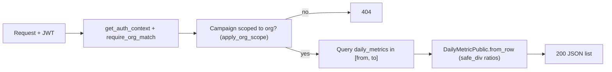

# API-02 — Dashboard Endpoints

## 1. Overview

API-02 adds the read-only backend endpoints the Sawakli AI dashboard needs to show an organization's
marketing campaigns and their daily performance:

1. List the organization's campaigns.
2. Get one campaign.
3. Get one campaign's daily metrics for a date range, with computed ratios (CTR, CPC, CPA, ROAS).

They exist so the frontend can render a campaign table and per-campaign performance charts without
doing any math or tenant filtering itself. They sit in the API layer (`apps/backend/src/sawakli/api`),
read data created by DATA-01 (`campaigns`, `daily_metrics` tables), and rely on the existing auth and
tenant-isolation helpers in `api/deps.py`.

## 2. Scope

### In Scope

- `GET /api/orgs/{org}/campaigns`
- `GET /api/orgs/{org}/campaigns/{campaign_id}`
- `GET /api/orgs/{org}/campaigns/{campaign_id}/metrics?from=YYYY-MM-DD&to=YYYY-MM-DD`
- ORM models `Campaign` and `DailyMetric`.
- Response schemas `CampaignPublic` and `DailyMetricPublic` (including the `safe_div` helper).
- `require_org_match` dependency and `OrgAuth` type alias in `api/deps.py`.
- Unit and integration tests for the above.

### Out of Scope

- **KPIs endpoint** (`GET /orgs/{org}/kpis`): dropped, "not required yet". Not built.
- Creating, updating or deleting campaigns or metrics (these endpoints are read-only).
- Data ingestion: connectors, OAuth and CSV endpoints belong to API-03.
- A `DataSource` model. `Campaign.data_source_id` has no `ForeignKey` in the model because no such
  model exists yet.
- The AI layer and its tests.
- Per-campaign totals in the campaign list (open question, see Section 16).

## 3. Prerequisites

| Task / Contract | Why Required |
|---|---|
| DATA-01 (schema and migrations) | Creates the `campaigns` and `daily_metrics` tables and the Postgres enum types the models map to. |
| Auth (JWT + bcrypt) | `get_auth_context` reads the organization from the token. |
| `api/deps.py` helpers | `DbSession`, `get_auth_context`, `apply_org_scope(statement, Model, organization_id)`. |
| Tenant isolation rules | Org comes from the JWT only; other orgs' rows return 404, not 403. |

Canonical contract and ADR links: not recorded in this document yet; add them in Section 17.

## 4. Architecture

```text
HTTP request (Bearer JWT)
↓
get_auth_context → org id from token
↓
require_org_match → {org} in URL must equal token org, else 404
↓
Route handler (api/routes/campaigns.py)
↓
apply_org_scope(select(...), Model, organization_id) → SQLAlchemy Session
↓
*Public schema (api/schemas) → JSON response
```

Ownership boundaries:

- **Routes** own request validation, the 404/422 decisions and query construction.
- **Schemas** own response shape and the ratio math (`safe_div`, `DailyMetricPublic.from_row`).
- **`deps.py`** owns authentication and tenant scoping. Routes never filter by organization by hand.
- **Models** own the table mapping only. They contain no business logic.

## 5. Step-by-Step Implementation Walkthrough

### Practical Outcome

A logged-in user can ask "which campaigns does my organization have?" and "how did campaign X perform
between two dates?" and get back clean JSON. Example: for 1 to 3 March, the metrics endpoint returns
three rows, each with raw spend, revenue, clicks, impressions and conversions plus ready-made CTR, CPC,
CPA and ROAS. A user can never see another organization's campaigns, and a foreign campaign id looks
exactly like a missing one (404).

Explanation of terms:

- **CTR**: click-through rate = clicks / impressions.
- **CPC**: cost per click = spend / clicks.
- **CPA**: cost per acquisition = spend / conversions.
- **ROAS**: return on ad spend = revenue / spend.
- Ratios are fractions (`0.025` means 2.5%).

### Acceptance Criteria → Steps and Evidence

The approved Notion task was not available when this document was written. The criteria below are
taken from the implementation handoff and must be reconciled with the Notion task before merge.

| Acceptance Criterion | Implementation Step(s) | Verification Evidence / Status |
|---|---|---|
| List endpoint returns only the token org's campaigns, ordered by name | 1, 3 | `tests/integration/api/test_dashboard_endpoints.py` (own-org data). Re-run after lint changes: NOT RUN |
| Single-campaign endpoint returns 404 when the campaign is missing or belongs to another org | 4 | Same file (foreign org/campaign → 404). Re-run: NOT RUN |
| Bad `campaign_id` UUID returns 422 | 4 | Same file. Re-run: NOT RUN |
| Unauthenticated requests return 401 | 3, 4, 5 | Same file (401 tests). Re-run: NOT RUN |
| `{org}` that differs from the token's org returns 404 | 3, 4, 5 | `tests/unit/api/test_org_scope.py` and the integration file. Re-run: NOT RUN |
| Metrics requires `from` and `to`; `from > to` returns 422 | 5 | Integration file (missing/invalid params). Re-run: NOT RUN |
| Metrics date range is inclusive and rows are ordered by date | 5 | Integration file (date range inclusive). Re-run: NOT RUN |
| Campaign ownership is checked before metrics, so a foreign id never looks like `[]` | 5 | Integration file (foreign campaign → 404). Re-run: NOT RUN |
| Ratios are computed correctly and are `null` when the denominator is 0 | 2, 5 | `tests/unit/api/test_metrics_schema.py`, integration file (null ratios). Re-run: NOT RUN |
| Empty date range returns `200 []` | 5 | Integration file. Re-run: NOT RUN |
| `ruff format`, `ruff check` and `mypy src tests` pass | 7 | ruff: PASS (Section 14). mypy: NOT RUN |

The handoff reports these tests as passing before the lint fixes in Step 7. Those fixes touched
source files, so the tests must be re-run (Section 14).

### Step 1 — Model the tables

- **What:** Map the existing `campaigns` and `daily_metrics` tables to SQLAlchemy 2.0 models so routes
  can query them.
- **Where:** `src/sawakli/db/models/campaign.py` (`Campaign`, `Platform`, `CampaignStatus`) and
  `src/sawakli/db/models/daily_metric.py` (`DailyMetric`).
- **How it works:** Both use `Mapped[...]` typing. `Platform` and `CampaignStatus` are `enum.StrEnum`
  classes mapped with `create_type=False`, because the Postgres enum types already exist from the
  DATA-01 migrations. `DailyMetric` has a composite primary key `(campaign_id, date)`, so there is at
  most one row per campaign per day. It uses `import datetime as dt` because the attribute is itself
  named `date`. `Campaign.data_source_id` has no `ForeignKey` in the model because there is no
  `DataSource` model.
- **Testing:** Exercised indirectly by the integration tests, which run against a database built by
  `alembic upgrade head`. Status: NOT RUN since the Step 7 changes.

### Step 2 — Response schemas and ratio math

- **What:** Define what the API returns, separate from the ORM models, and compute the ratios in one
  place.
- **Where:** `src/sawakli/api/schemas/campaigns.py` (`CampaignPublic`) and
  `src/sawakli/api/schemas/metrics.py` (`safe_div`, `DailyMetricPublic.from_row`).
- **How it works:** `CampaignPublic` is built from a `Campaign` row. `DailyMetricPublic.from_row` takes
  a `DailyMetric` row, converts `Decimal` values to plain `float`/`int`, and fills `ctr`, `cpc`, `cpa`
  and `roas` using `safe_div`, which returns `None` when the denominator is 0.
- **Testing:** `tests/unit/api/test_campaign_schema.py` and `tests/unit/api/test_metrics_schema.py`.
  Status: NOT RUN since Step 7.

### Step 3 — List campaigns

- **What:** Return every campaign of the token's organization.
- **Where:** `api/routes/campaigns.py`, `GET /api/orgs/{org}/campaigns`.
- **How it works:** `require_org_match` validates `{org}` against the token. The handler selects
  `Campaign`, wraps the statement in `apply_org_scope`, orders by `name`, and returns
  `list[CampaignPublic]`.
- **Testing:** Integration tests for 401, own-org data and a second org's data staying hidden.
  Status: NOT RUN since Step 7.

### Step 4 — Get one campaign

- **What:** Return a single campaign, never leaking whether another org owns the id.
- **Where:** `api/routes/campaigns.py`, `GET /api/orgs/{org}/campaigns/{campaign_id}`.
- **How it works:** `campaign_id` is parsed as a `UUID` (invalid value → 422). The handler runs a
  scoped `select` (never `db.get`). No row, whether missing or foreign, gives 404.
- **Testing:** Integration tests for own campaign, foreign campaign, unknown id and malformed UUID.
  Status: NOT RUN since Step 7.

### Step 5 — Campaign daily metrics

- **What:** Return daily rows for one campaign in a required date range, with computed ratios.
- **Where:** `api/routes/campaigns.py`, `GET /api/orgs/{org}/campaigns/{campaign_id}/metrics`.
- **How it works:** `from` and `to` are required query parameters; `from > to` gives 422. The handler
  first confirms the campaign belongs to the token's org (404 otherwise), then selects `DailyMetric`
  rows for that campaign with `date` between `from` and `to` inclusive, ordered by date, and maps each
  row through `DailyMetricPublic.from_row`. No rows in range gives `200 []`.
- **Testing:** Integration tests for inclusive range, empty range, missing/invalid parameters, foreign
  campaign and null ratios. Status: NOT RUN since Step 7.

### Step 6 — Tests

- **What:** Cover schemas, scoping and endpoints.
- **Where:** `tests/unit/api/test_campaign_schema.py`, `test_metrics_schema.py`, `test_org_scope.py`
  (22 unit tests) and `tests/integration/api/test_dashboard_endpoints.py` (13 integration tests).
  Fixtures and helpers (`client`, `db_session`, `register_user`, `login_user`, `auth_header`,
  `insert_job`, `insert_campaign`) come from `tests/conftest.py`, which was not changed.
- **How it works:** Integration tests run against the test database
  (`postgresql+psycopg://…@localhost:5434/sawakli_test`). The `migrated_database` fixture runs
  `alembic upgrade head`. The `client` teardown deletes jobs, members, users and orgs after each test,
  and campaigns, metrics and data sources go away by cascade.
- **Testing:**
  - `uv run python -m pytest tests/unit/api -v`
  - `uv run python -m pytest tests/integration/api -v`
  - Status: NOT RUN since Step 7.

### Step 7 — Quality checks (ruff and mypy)

- **What:** Make the new code pass the project's lint and type rules (ruff line length 100, rules
  `E,F,I,B,UP`; mypy strict).
- **Where:** `apps/backend`, configured in `pyproject.toml`.
- **How it works:** `ruff check` initially reported 6 errors, all fixed:
  - Unsorted imports (`I001`) in `api/main.py`, `api/routes/campaigns.py` and
    `api/schemas/campaigns.py`, fixed with `--fix`.
  - Unused `fastapi.Query` import (`F401`) in `api/routes/auth.py`, fixed with `--fix`.
  - `(str, enum.Enum)` (`UP042`) on `Platform` and `CampaignStatus`, changed to `enum.StrEnum` with
    `--unsafe-fixes`. "Unsafe" because `str(member)` now returns the value (`"meta"`) instead of
    `"Platform.meta"`; nothing in the dashboard code relies on the old behavior.
- **Testing:** `ruff format .` and `ruff check .` are PASS (Section 14). `mypy src tests` is NOT RUN.

### Flow Diagram



## 6. Inputs

| Field / Input | Type | Required | Source | Description |
|---|---|---|---|---|
| `Authorization: Bearer <JWT>` | header | Yes | Client | Identifies the user and the organization. Missing or invalid gives 401. |
| `{org}` | path | Yes | URL | Only validated against the token's org. Mismatch gives 404. It is never used to choose data. |
| `campaign_id` | UUID (path) | Yes (endpoints 2, 3) | URL | Invalid UUID gives 422. Resolved through an org-scoped query. |
| `from` | date `YYYY-MM-DD` (query) | Yes (endpoint 3) | URL | Inclusive start. Missing or invalid gives 422. |
| `to` | date `YYYY-MM-DD` (query) | Yes (endpoint 3) | URL | Inclusive end. `from > to` gives 422. |

The organization used for all queries always comes from the JWT, never from the URL, body or query.

## 7. Outputs

**Campaign endpoints** return `CampaignPublic`. The exact field list is defined in
`src/sawakli/api/schemas/campaigns.py`.

> TODO: copy the `CampaignPublic` field table here from the schema file (not available when this
> document was written; fields are intentionally not guessed).

**Metrics endpoint** returns `list[DailyMetricPublic]`, ordered by date ascending.

| Field / Output | Type | Nullable | Consumer | Description |
|---|---|---|---|---|
| `date` | date | No | Dashboard charts | The day the row describes (the model's `date` attribute). |
| `spend` | float | No | Dashboard | Raw spend (Decimal converted to float). |
| `revenue` | float | No | Dashboard | Raw revenue (Decimal converted to float). |
| `clicks` | int | No | Dashboard | Raw clicks. |
| `impressions` | int | No | Dashboard | Raw impressions. |
| `conversions` | int | No | Dashboard | Raw conversions. |
| `ctr` | float | Yes | Dashboard | clicks / impressions; `null` if impressions = 0. |
| `cpc` | float | Yes | Dashboard | spend / clicks; `null` if clicks = 0. |
| `cpa` | float | Yes | Dashboard | spend / conversions; `null` if conversions = 0. |
| `roas` | float | Yes | Dashboard | revenue / spend; `null` if spend = 0. |

> TODO: confirm in `schemas/metrics.py` that the date field is named `date` and that no other fields
> (for example `campaign_id`) are returned.

## 8. Rules and Semantics

- **Ratios:** `ctr = clicks / impressions`, `cpc = spend / clicks`, `cpa = spend / conversions`,
  `roas = revenue / spend`. Computed per day from that day's raw values by `safe_div`.
- **Zero denominators:** the ratio is `null`, never `0`, `inf` or an error.
- **Units:** ratios are fractions (`0.025` = 2.5%). Money values are plain numbers; this endpoint does
  not carry a currency.
- **Date range:** `from` and `to` are both required and inclusive. `from > to` gives 422. There is no
  maximum range (see Section 15).
- **Ordering:** campaigns ordered by `name`; metrics ordered by `date` ascending.
- **Missing days:** days with no row are simply absent. The API does not fabricate zero rows.
- **Duplicates:** cannot occur at row level, because `(campaign_id, date)` is the primary key.
- **Determinism:** the same data and the same parameters always give the same output.
- **Ownership check first:** the metrics endpoint verifies the campaign belongs to the token's org
  before querying metrics, so a foreign id returns 404 and never an empty list.

## 9. Public Interfaces

All three are `GET`, have no side effects, and mount under `prefix="/api/orgs/{org}/campaigns"`. The
router includes `/api` itself, so `sawakli.api.main` includes it without an extra prefix.

| Endpoint | Input | Output | Errors |
|---|---|---|---|
| `GET /api/orgs/{org}/campaigns` | JWT | `list[CampaignPublic]` | 401; 404 (org mismatch) |
| `GET /api/orgs/{org}/campaigns/{campaign_id}` | JWT, UUID | `CampaignPublic` | 401; 404 (org mismatch, missing or foreign campaign); 422 (bad UUID) |
| `GET /api/orgs/{org}/campaigns/{campaign_id}/metrics` | JWT, UUID, `from`, `to` | `list[DailyMetricPublic]` | 401; 404 (org mismatch, missing or foreign campaign); 422 (bad UUID, missing or invalid dates, `from > to`) |

Database access: reads from `campaigns` and `daily_metrics` only.

## 10. Data Ownership

### Reads

- `campaigns`, always through `apply_org_scope` with the token's organization id.
- `daily_metrics` for a campaign that was first confirmed to belong to the token's organization.

### Writes

- None. All three endpoints are read-only.

### Must Never Read

- Rows of any other organization.
- An organization id taken from the URL, body or query string to decide what data to return.
- Org-owned data via `db.get(Model, id)`, which bypasses the organization scope.

### Must Never Write

- `campaigns`, `daily_metrics`, or any other table from these endpoints.

## 11. Security

- **Authentication:** every endpoint requires a valid JWT (python-jose). Missing or invalid gives 401.
- **Organization isolation:** the org comes from the token. `{org}` is only validated against it. Every
  org-owned query goes through `apply_org_scope`. Another org's rows give 404 (not 403), so ids cannot
  be probed to discover what exists.
- **Metrics:** the campaign ownership check runs before the metrics query, so a foreign campaign id
  cannot be distinguished from a nonexistent one.
- **Response shape:** responses use separate `*Public` schemas, so internal columns (for example
  `data_source_id` or organization ids) are only exposed if they are listed in those schemas.
- **Secrets and tokens:** none handled by these endpoints. No OAuth tokens are read or returned.

## 12. Error and Edge-Case Behavior

| Case | Expected Behavior |
|---|---|
| Missing token / invalid token | 401. |
| Missing `from` or `to` | 422. |
| Malformed `campaign_id` or date | 422. |
| `from` later than `to` | 422. |
| `{org}` differs from token org | 404. |
| Campaign missing or owned by another org | 404 (same response for both). |
| Zero denominators | Ratio is `null`; the row is still returned. |
| No data in range | `200 []`. |
| Duplicate records | N/A: `(campaign_id, date)` primary key prevents duplicate daily rows. |
| Database failure | No endpoint-specific handling and no test; default FastAPI error response applies. |
| Provider or API failure | N/A: endpoints make no external calls. |
| Timeout | N/A: no endpoint-level timeout is configured. |
| Cancellation | N/A: handlers are synchronous and read-only. |

## 13. Testing

### Unit Tests

22 tests in `tests/unit/api/`:

- `test_campaign_schema.py`: `CampaignPublic` is built correctly from a `Campaign` row.
- `test_metrics_schema.py`: `safe_div` and `DailyMetricPublic.from_row` (raw fields, ratio values,
  `null` on zero denominators, Decimal to float/int).
- `test_org_scope.py`: `apply_org_scope` and `require_org_match` behavior (uses fakes).

### Integration Tests

13 tests in `tests/integration/api/test_dashboard_endpoints.py`, against the Postgres test database:

- 401 without or with an invalid token.
- Own-org data is returned; another org's campaign gives 404.
- Inclusive date range and ordering by date.
- Empty results return `200 []`.
- 422 on missing or invalid parameters and on `from > to`.
- Null ratios on zero denominators.

### E2E Impact

None yet. No frontend flow consumes these endpoints in this task.

## 14. Verification

Commands executed (from `apps/backend`, Windows + Git Bash, Python 3.12.10, via `uv`):

```bash
uv run ruff format .
uv run ruff check .
uv run ruff check . --fix
uv run ruff check . --fix --unsafe-fixes
uv run ruff format .
uv run ruff check .
```

Results:

- 2026-10-20, local, branch `API-02`: `ruff format .` left 171 files unchanged. The first
  `ruff check .` found 6 errors. `--fix` fixed 4; `--fix --unsafe-fixes` fixed the last 2. Final
  `ruff format .` (171 files unchanged) and `ruff check .` (`All checks passed!`): **PASS**.
- `uv run mypy src tests`: **NOT RUN** (next step).
- `uv run python -m pytest tests/unit/api -v`: **NOT RUN** since the ruff fixes. Handoff reported
  passing before them.
- `uv run python -m pytest tests/integration/api -v`: **NOT RUN** since the ruff fixes. Handoff
  reported passing before them.
- CI (ruff, mypy, pytest, `alembic upgrade head`) and pull request evidence: **NOT RUN**, PR not yet
  opened.

The ruff fixes edited `api/main.py`, `api/routes/auth.py`, `api/routes/campaigns.py`,
`api/schemas/campaigns.py` and `db/models/campaign.py`, so tests must be re-run before this section is
marked PASS.

## 15. Known Limitations

- No cap on the metrics date range. A very large range returns every row.
- The campaign list is not paginated.
- Metrics are returned as `float`, so very large or very precise money values may lose precision
  compared with the `Decimal` stored in the database.
- The campaign list carries no per-campaign totals (spend, clicks and so on).
- `Campaign.data_source_id` has no database-level link in the model until a `DataSource` model exists.
- The KPIs endpoint does not exist. If asked later: required `from`/`to`, SUM over `daily_metrics`
  scoped by org, ratios computed from the sums (never averaged daily ratios), `coalesce(sum, 0)` so an
  empty range gives zeros with null ratios.
- The AI layer is not covered by these endpoints or their tests.

## 16. Follow-Up Tasks

- `INT-01` — owner TBD — decide whether the campaign table needs per-campaign totals (would require a
  join to `daily_metrics`) and confirm these response shapes.
- Date range cap (for example 366 days) — owner TBD — decide whether to enforce a maximum for the
  metrics endpoint.
- KPIs endpoint — owner TBD — only if requested.
- Re-run `mypy`, `pytest` and CI, then open the PR for `API-02` (required completion work, tracked in
  Section 14).

## 17. References and Evidence

- Notion task: TBD
- Pull request: not yet opened (branch `API-02`)
- Canonical contracts: TBD
- ADRs: TBD
- Related technical documentation: DATA-01 schema and migrations; `api/deps.py`
- Test or CI evidence: see Section 14
