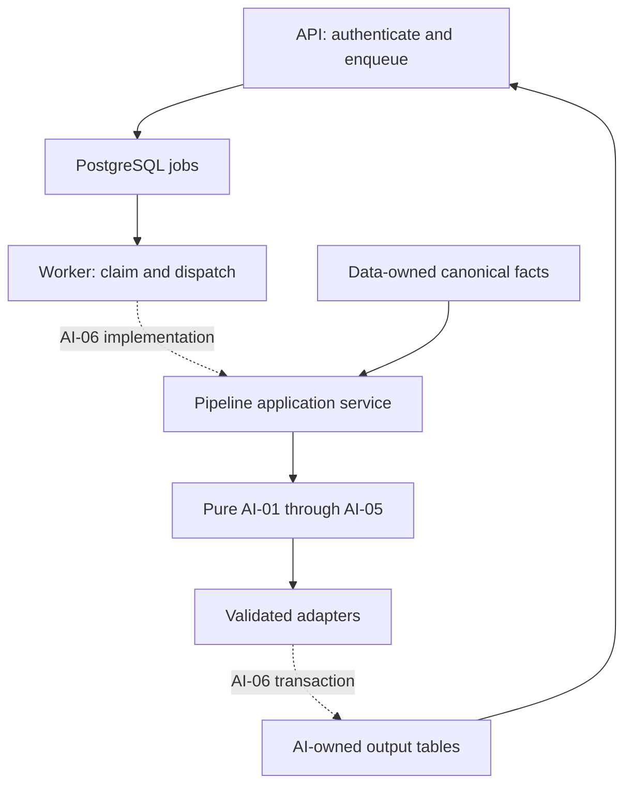

# ARCH-03 - AI Pipeline and Persistence Interfaces

## 1. Overview

ARCH-03 provides a concrete integration contract for existing AI modules and their
Worker/API consumers. Prepared on 23 October 2026 from main `4f71cf8d2b9afda36c64108fe65fc03de7cf3804`.
The package includes decisions, typed inputs/results, pure safety adapters, six linked
contract examples and CI validation. It does not implement the AI-06 orchestrator.

Delivery status: implementation and validation fixes are published on
`arch/arch-03-ai-contracts`. The authenticated CLI push and remote branch SHA were
verified on 23 October 2026. All five CI jobs passed on the implementation head
(see section 14). Affected-owner review remains required; ADR 0002 is prepared for
review, not Accepted. No merge is authorized.

## 2. Scope

In scope: tenant input, run identity, cancellation/result interfaces, canonical output
mapping, labeled evaluation reference, simulator ownership, fixtures and implementation deltas.

Out of scope: scenario formulas, a production orchestrator, DB writes, HTTP routes,
schema/role rollout, distributed lease recovery, provider actions and full-product E2E.
Those remain AI-05/06/07, WORK-04, API-05 and the ADR 0001 follow-ups.

## 3. Prerequisites

| Source | Use |
|---|---|
| TRK-03, marked Done in Notion | AI baseline and interface gap review |
| AI-01 through AI-04 and AI-02 reference benchmark | Existing analytical types and quality evidence |
| Current API-04 and Worker code | Real queue, statuses and dispatch gap |
| ADR 0001 | Accepted modular-monolith/runtime-role boundary |
| canonical.json and migration 0004 | Real required fields, enums and foreign keys |
| ARCH-02/05/06 teammate PDFs | Review context; differing names are reconciled, not copied as code facts |

## 4. Architecture

Shared definitions live once in the [contract](../contracts/ai-pipeline-and-persistence.md).
Decision rationale is [ADR 0002](../adr/0002-ai-pipeline-and-persistence-boundaries.md).

Dotted arrows are future runtime wiring. The adapters and types themselves exist in this change.
Use current `/api/analysis/refresh` and `/api/jobs/{job_id}/status`; no new HTTP interface.

## 5. Step-by-Step Implementation Walkthrough

### Practical outcome

A Worker owner can build a valid request, the AI owner can validate and translate module
outputs without guessing, and the API owner has linked examples of rows to consume.

| Acceptance criterion | Steps | Evidence |
|---|---|---|
| Tenant-scoped input and labeled evaluation contracts | 1, 2, 4 | Typed guards, fixture/evaluator references and tests |
| Simulator/persistence ownership without a cycle | 1, 3 | Explicit AI-05 calculation / AI-06 storage split; correlated batch |
| AI/API/Worker implementation deltas | 1, 5 | Contract section 7 owner matrix |
| Run/output fixture and cancellation interface | 2, 4 | Six examples, terminal outcome mapping and failure examples |

### Step 1 - Record decisions before implementing the boundary

- **What:** settle source, ownership, publication and failure rules.
- **Where:** ADR 0002 and the canonical integration contract.
- **How it works:** compare task requirements, current code, migrations and teammate
  references. Retain simple in-process execution and whole-run atomic publication.
- **Testing:** reconcile the acceptance table and explicit downstream owner matrix.
  Architecture review is not fabricated as a passed test.

### Step 2 - Define immutable requests and outcomes

- **What:** give the Worker and AI one exact internal handoff.
- **Where:** `ai/contracts.py`; `PipelineRequest`, `PipelineOutcome`, `CancellationCheck`.
- **How it works:** a single organization, stable job/run identity, fixed cutoff and
  optional nonempty campaign selection. Pydantic rejects invalid/unknown fields.
  `validate_feature_scope` rejects foreign organization/campaign, future dates and duplicates.
- **Testing:** positive JSON examples, malformed requests, tenant leakage and terminal
  outcome inconsistencies; actual results are in section 14.

### Step 3 - Translate analytical outputs without changing algorithms

- **What:** bridge the actual AI-02/03 shapes to existing consumers safely.
- **Where:** `ai/integration.py`; `to_anomaly_signal`, `persistable_forecasts`, `job_status_for`.
- **How it works:** explicit metric evidence supplies above/below direction; a critical
  campaign score maps to high canonical severity. Missing forecast values are omitted.
  The Worker checks returned organization/job/run identity before applying status.
- **Testing:** exact Decimal 0.80 boundary, hand-calculable CPA 80 versus 20, mismatched
  evidence, invalid forecast numbers and foreign outcomes. No detector thresholds change.

### Step 4 - Publish fixtures and executable contract checks

- **What:** demonstrate normal, no-data, degraded, cancelled and failed handoffs.
- **Where:** `tests/contracts/ai-pipeline-v1.json`, `validate-ai-pipeline.mjs`,
  `tests/unit/ai/test_pipeline_contracts.py`.
- **How it works:** synthetic request/outcome examples include linked canonical rows,
  recommendation/simulation correlation and the existing evaluation manifest. Illustrative
  output values are not asserted to be real detector predictions or inserted DB rows.
- **Testing:** canonical shape/enums/FKs/tenant/run checks and injected invalid fixtures;
  real AI-01 engineering and AI-03 degraded forecasts are exercised by Python tests.

### Step 5 - Integrate governance and prepare handoff

- **What:** ensure the new contract is discoverable and checked by existing CI.
- **Where:** `scripts/run-contracts.mjs`, docs index, AI-02/04 documentation,
  recommendation schema comments and forecast-deviation explanation.
- **How it works:** add the validator to the existing contract job; retain all previous
  validators and allowlist enforcement. No canonical schema or unrelated deviation is removed.
- **Testing:** Ruff, strict mypy, backend unit tests, contract runner, documentation
  governance and whitespace verification. The PDF is a submission view of this repository evidence.

## 6. Inputs

See contract sections 2 and 6 for exact request and evaluation definitions. Production
input remains canonical organization-scoped facts through AI-01, not provider payloads
or secrets. Benchmark ground truth is generated before predictions; original Nour labels
are still unavailable. Date cutoff is job-created UTC date, avoiding new storage fields.

## 7. Outputs

Implemented: typed request/outcome/evidence/simulation contracts, pure boundary functions,
six JSON examples, validator, tests and maintained documentation.

Specified for later implementation: run_pipeline, transaction publication, cancellation
entry point, real output writes and stored API responses. Output row definitions remain
canonical.json; the fixture is an example, not a second schema.

## 8. Rules and Semantics

See canonical integration contract sections 2-6. Key choices: one organization per
request; history through fixed as_of; critical-only anomaly publication with explicit
metric evidence; no zero-filled forecasts; three seven-day simulation scenarios; unavailable
ratio markers; one atomic publication per run; stable run ID and replay; cancellation
and publication serialize on the job row. Model formulas and benchmark gates are unchanged.

## 9. Public Interfaces

| Interface | Behavior |
|---|---|
| PipelineRequest / PipelineOutcome | Frozen validated internal transport, not HTTP payloads |
| MetricEvidence / SimulationBatch | Explicit typed evidence and simulator correlation |
| validate_feature_scope | Returns ordered features or ContractError |
| to_anomaly_signal | Returns canonical AI-04 signal or None; rejects inconsistent evidence |
| persistable_forecasts | Returns usable numeric records; omits legitimate placeholders |
| job_status_for | Returns canonical JobStatus only after scope/identity checks |
| validate-ai-pipeline.mjs | Validates fixture; nonzero exit on mismatch; exercises negative cases |

No public persistence or cancellation endpoint is added here.

## 10. Data Ownership

### Reads

Helpers read caller-supplied in-memory records. The validator reads committed synthetic
fixtures and canonical.json. No helper opens a database session.

### Writes

No runtime persistent writes. This change adds repository contract/evidence files.
Future database ownership is explicitly defined by the linked contract.

### Must Never Read

Users, OAuth credentials, raw provider payloads and unauthorized tenant facts.

### Must Never Write

Canonical marketing facts, user decisions, provider actions, historical migrations or
another layer's tables. An AI retry must not overwrite recommendation decisions.

## 11. Security

Organization scope is explicit in requests, evidence, results and linked rows. Feature
guards are defense in depth, not authentication. Production Worker verifies job ownership;
API still authenticates callers. Runtime role/RLS enforcement remains deferred under
ADR 0001; these unit tests cannot prove database-level secret isolation.

## 12. Error and Edge-Case Behavior

| Case | Result |
|---|---|
| Empty/duplicate campaign selection | ValidationError |
| Foreign tenant/campaign, future day, duplicate feature day | ContractError |
| Empty workspace | Specified SUCCESS + no_data, no rows |
| Insufficient forecast history | Omit placeholder; warning belongs to future orchestrator |
| Missing/invalid usable forecast | ContractError, never fabricated zero |
| Subcritical/equal-value anomaly evidence | No signal |
| Unknown/insufficient metric evidence | ValidationError or ContractError |
| Zero simulation denominator | Required unavailable marker and zero sentinel |
| Cancellation/failure | Typed outcome; invalid input is never retryable; no partial publication in v1 |
| DB/provider failure or timeout | No such IO in helpers; future lifecycle defined in contract |

## 13. Testing

Unit tests cover tenant/date boundaries, mutation protection, metric-vs-performance
direction, exact threshold, valid/invalid forecasts, simulator coverage/markers and
identity-safe terminal mapping. Existing feature engineering and forecasting are reused.

Contract tests validate synthetic linked rows against canonical fields/types/enums and
reject 27 injected corruptions, including impossible dates, unknown fields/warnings,
nonboolean flags, duplicate scenarios, missing evidence and lost unavailable-ratio markers.
The publication review reproduced five invalid fixtures being accepted before the fix;
the CLI now rejects each. Existing QA-00 negative tests remain active.

Production DB concurrency, cancellation races and retry idempotency tests are required
for AI-06/WORK-04 adoption, not claimed as executed by this architecture task.

## 14. Verification

23 October 2026, CPython 3.12.3 and Node 24.22.1, isolated temporary checkout and
virtual environment. These results supersede the handoff's historical local results.

| Command / check | Observed result |
|---|---|
| Backend `ruff check .` | PASS |
| Backend `ruff format --check .` | PASS - 174 files |
| Backend `mypy src` | PASS - 97 source files, strict configuration |
| Backend `pytest tests/unit/ai/test_pipeline_contracts.py -q` | PASS - 48 tests |
| Backend `pytest tests/unit -q` | PASS - 259 tests, zero skips, 2 dependency deprecation warnings |
| Root `node scripts/run-contracts.mjs` | PASS - six commands; 27 ARCH-03 corruptions and 23 existing QA negative cases rejected |
| CLI `node tests/contracts/validate-ai-pipeline.mjs --fixture <invalid-file>` | PASS - five external corrupt fixtures accepted before the fix now exit nonzero |
| Root `bash .github/scripts/check-documentation-governance.sh origin/main HEAD` | PASS - actual PR base is main at `4f71cf8` |
| `git diff --check` and staged whitespace check | PASS |
| Local PostgreSQL/migration checks | NOT RUN - PostgreSQL binaries unavailable; configured Backend CI supplies real PostgreSQL and migration round-trip |
| Local Compose integration | NOT RUN - Docker client exists but no running daemon; configured Integration CI is required |
| Full product E2E and AI-06 cancellation/retry races | NOT RUN - production wiring is downstream scope |
| Remote branch push | PASS - authenticated push; exact SHA confirmed with `git ls-remote` |
| Remote CI | PASS - all five jobs on implementation head `4f2b10b3c614b01d94b5c1df14d1fbfc05938f5b`, [run 40007705822](https://github.com/elfaroukomaradmission-a11y/Sawakli-AI/actions/runs/40007705822); final documentation-head rerun evidence is recorded in PR #32 and the submission package |
| Independent affected-owner review | NOT RUN - awaiting human review |

The 48 ARCH-03 tests are included in the 259 unit tests. Benchmark replays for both
reference seeds ran in the unit suite; fixture examples still do not claim model output
or DB execution. Fresh dependencies satisfy the project ranges. Contract subprocesses
required execution outside the restricted sandbox after EPERM; the complete runner then
passed. No allowlist entries or valid checks were removed.

## 15. Known Limitations

- This package specifies runtime wiring; it does not execute/persist the production pipeline.
- Metric evidence extraction and latest-day signal selection remain AI-06 work.
- Critical reference-benchmark quality is not per-metric attribution or real-world quality.
- Missing historical Nour labels remain missing.
- Seven-day simulator math and unavailable-ratio API projection need downstream implementation.
- Serial retry/cancellation publication protocol needs real PostgreSQL concurrency tests.
- Runtime-role separation and advanced overlapping-worker recovery remain separately gated.
- Cross-owner review remains required before adoption; publication and implementation CI are confirmed.

## 16. Follow-Up Tasks

The complete owner/delta matrix is contract section 7: AI-05 calculation, AI-06 pipeline
and persistence, AI-07 security acceptance, WORK-04 direct handoff/recovery, API-05 stored
responses, Data role/migration follow-ups, and QA contract reconciliation. No new tasks
or schedule changes are created by ARCH-03.

## 17. References and Evidence

- [Notion ARCH-03](https://app.notion.com/p/3e57de83a91b819b8dedc15885353d2e)
- [Canonical integration contract](../contracts/ai-pipeline-and-persistence.md)
- [ADR 0002](../adr/0002-ai-pipeline-and-persistence-boundaries.md)
- [Accepted runtime ADR](../adr/0001-runtime-boundaries-and-database-roles.md)
- [Existing benchmark](../testing/AI-02-seeded-benchmark.md)
- [Canonical DB/output fields](../../tests/contracts/canonical.json)
- [Worked fixtures](../../tests/contracts/ai-pipeline-v1.json)
- [Pull request #32](https://github.com/elfaroukomaradmission-a11y/Sawakli-AI/pull/32)
- [Base main commit](https://github.com/elfaroukomaradmission-a11y/Sawakli-AI/commit/4f71cf8d2b9afda36c64108fe65fc03de7cf3804)
- Teammate source attachments: ARCH-02 API Layer Guide (4 pages), ARCH-05 Task Completion
  Summary (1 page), ARCH-06 frontend API/state conventions (10 pages), read for the baseline.
- Publication evidence and exact-head CI are linked from the PR; no merge, fixture DB insert or independent approval is claimed.
