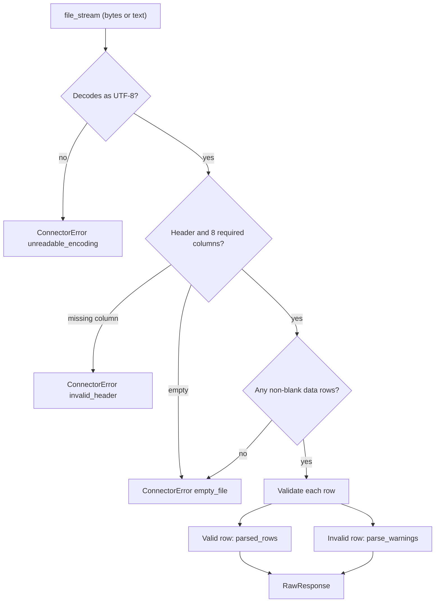

# CONN-01 — Build Connector Package and CSV/Demo Parser

## 1. Overview

| Item | Value |
|---|---|
| Task | CONN-01 — Build Connector Package and CSV/Demo Parser |
| Layer | Connector |
| Owner | Mohamed Hassan (reassigned from Youssef Halawa, the original assignee) |
| Status | **Implemented** — merged to `main` on 24 Aug 2026 (pull request #1); corrected on 21 Oct 2026 (pull request #30) |
| Document type | Retroactive task document, written on 21 Oct 2026 for work merged before task documentation became mandatory |

CONN-01 delivered `parse_csv_upload()`, the function that turns an uploaded CSV file into validated
campaign rows, and the shared `ConnectorError` envelope that every connector in
`sawakli.connectors` returns on failure.

It exists because the Month-One MVP has no live advertising-platform connection. The CSV/demo
path is the guaranteed ingestion route for the demo (Notion card Objective: "Provide the guaranteed
Month-One demo ingestion path through a common connector interface"). The parser is pure: it reads
a file stream and returns a value. It performs no database, network or file-system writes.

In the system, the parser sits between the Backend upload endpoint and the Data layer's ingestion
pipeline. The Backend calls it; the Data layer persists what it returns. That later wiring was
added by other tasks and is described here only as downstream use.

## 2. Scope

### In Scope

- `parse_csv_upload(file_stream, org_id, upload_id)` in
  [`connectors/csv/parser.py`](../../apps/backend/src/sawakli/connectors/csv/parser.py).
- The `RawResponse` result type and the CSV-specific `ParseErrorKind` enum in the same module.
- Package exports in [`connectors/csv/__init__.py`](../../apps/backend/src/sawakli/connectors/csv/__init__.py).
- The shared `ConnectorError` dataclass in
  [`connectors/errors.py`](../../apps/backend/src/sawakli/connectors/errors.py).
- 14 unit tests in
  [`tests/unit/connectors/csv/test_parser.py`](../../apps/backend/tests/unit/connectors/csv/test_parser.py).

### Out of Scope

- Persisting rows, raw payloads or upload status. These belong to the Data layer under
  [ARCH-04](../architecture/ARCH-04-connector-to-data-handoff-contracts.md) and
  [ING-01](../data/ING-01-csv-upload-ingestion-handoff.md).
- The HTTP upload endpoint. `POST /csv/{data_source_id}/upload` was added later by pull request #16
  and ING-01 (see Section 4).
- Business plausibility checks such as missing-day coverage (PROD-01 assigns the ">30% of expected
  days missing" rule to `INSUFFICIENT_DATA` handling, not to parsing).
- OAuth tokens and provider APIs (CONN-02, CONN-03).
- A shared connector base interface. `connectors/base.py` was not changed by this task (Section 15).

## 3. Prerequisites

| Task / Contract | Why Required |
|---|---|
| PROD-01 — Freeze Demo Story, KPI Set, CSV Template & Acceptance Scope | Defines the `campaign_data.csv` template: 10 columns, 8 required, UTF-8, header row required, `YYYY-MM-DD` dates, negative values reject the row (`PROD-01_Month-One_Scope_Freeze.pdf`, Section 3) |
| DEV-01 — Establish Shared Monorepo, Docker Compose & CI Baseline | Provides the package skeleton (`connectors/`, `errors.py`, `base.py`) and the CI gates (commit `99c668f`) |
| INT-01 — Canonical MVP Contract Pack | Defines the `parse_csv_upload` signature and result in §2.7 and states that the Connector layer "only parses structure" (`INT-01_Canonical_MVP_Contract_Pack.pdf`, §2.7) |

The Notion card lists PROD-01 and DEV-01 as Prerequisites. INT-01 is listed here because the
function signature comes from it.

Current canonical sources that govern how the output is consumed:

- [RawResponse and Canonical Handoff Contract](../contracts/raw-response-canonical-handoff.md)
- [ARCH-04 — Connector-to-Data Handoff Contracts](../architecture/ARCH-04-connector-to-data-handoff-contracts.md)

## 4. Architecture

```text
CSV bytes or text (uploaded file)
↓
parse_csv_upload()            Connector layer, pure function (CONN-01)
↓
RawResponse | ConnectorError
↓
Backend upload route          maps ConnectorError to HTTP 422 (added later, PR #16 / ING-01)
↓
Data ingestion service        persists raw payload and canonical rows (ING-01)
```

Ownership boundaries:

- **Connector (this task):** decode, check the header, validate and clean each row, and report
  problems. It never writes to PostgreSQL and never deduplicates.
- **Backend:** authenticates the caller, checks that the data source belongs to the caller's
  organization, and calls the parser
  ([`api/routes/connectors.py:103`](../../apps/backend/src/sawakli/api/routes/connectors.py#L103)).
- **Data:** stores the raw upload and the canonical facts, following the
  [handoff contract](../contracts/raw-response-canonical-handoff.md).

Downstream consumers on `main` today (not part of CONN-01):

| Consumer | Evidence |
|---|---|
| `POST /csv/{data_source_id}/upload` | [`api/routes/connectors.py:15,103`](../../apps/backend/src/sawakli/api/routes/connectors.py#L103); added by commit `6796721` (pull request #16, merged 1 Oct 2026), changed by commit `f039867` (ING-01) |
| QA-02 connector-to-canonical E2E test | [`tests/integration/data/test_connector_to_canonical_e2e.py:118`](../../apps/backend/tests/integration/data/test_connector_to_canonical_e2e.py#L118); [QA-02 document](../testing/QA-02-connector-to-canonical-e2e.md) |

Pull request #18 (API-03) also wrapped the parser, but it was closed without merging on
17 Oct 2026.

## 5. Step-by-Step Implementation Walkthrough

### Practical Outcome

A user uploads a `campaign_data.csv` file. The parser either accepts the file and returns the
usable rows, or rejects the whole file with a clear reason. A file with one bad row among many good
rows is not rejected: the bad row is skipped and listed in `parse_warnings` with its row number,
for example `Row 3: 'spend' is negative (-5)`. A file with no usable header is rejected with
`invalid_header` and a message that names the missing columns.

Every connector shares the same failure shape, `ConnectorError`, so the API and UI can show one
kind of error regardless of which connector produced it.

Steps 1–5 are the original delivery (**Implemented**, pull request #1). Step 6 records a
post-merge correction made in pull request #30: files saved as "UTF-8 with BOM" are now
accepted.

### Acceptance Criteria → Steps and Evidence

The criteria are the Definition of Done on the Notion card, quoted verbatim.

| Acceptance Criterion | Implementation Step(s) | Verification Evidence / Status |
|---|---|---|
| CSV parser returns the common RawResponse shape. | 2, 5 | PASS — `test_fully_valid_file` asserts a `RawResponse` with `row_count`, `parsed_rows` and `parse_warnings` (CI run 32722360428, re-run 21 Oct 2026; Section 14) |
| Valid files parse successfully. | 4, 5 | PASS — `test_fully_valid_file`, `test_stringio_input_also_works`, `test_optional_columns_default_when_absent_from_header` (Section 14) |
| Invalid header, encoding and empty-file cases produce typed errors or row warnings. | 3, 4, 6 | PASS — `test_missing_required_column_in_header`, `test_badly_encoded_file_is_unreadable_encoding`, `test_truly_empty_file`, `test_empty_file_header_only_no_data_rows`, five row-warning tests, and the three UTF-8 byte-order-mark tests added in Step 6 (Section 14) |
| Approved sample demo file passes. | 5 | NOT RUN — no approved sample file is committed to the repository (also recorded by the [TRK-06 register](../testing/TRK-06-integrated-baseline-register.md), §13.4). Partial evidence: on 21 Oct 2026 the QA-02 fixture `tests/fixtures/qa-02-demo.csv` (3 rows, added later by commit `6796721`) parsed with `row_count` 3 and no warnings |

### Step 1 — Define the shared connector error

- **What:** Replace the one-line `errors.py` stub from the repository scaffold with a reusable
  failure envelope.
- **Where:** [`connectors/errors.py:8-22`](../../apps/backend/src/sawakli/connectors/errors.py#L8-L22),
  `ConnectorError`.
- **How it works:** `ConnectorError` is a frozen dataclass with `kind`, `message`, `user_message`
  and `retryable` (default `False`). `kind` plays the role of the `code` field used in the API's
  `{code, message, user_message, retryable}` error convention, so the upload route can map it to a
  response without reshaping
  ([`api/routes/connectors.py:105-114`](../../apps/backend/src/sawakli/api/routes/connectors.py#L105-L114)).
  Each connector defines its own `kind` values; CONN-02 reuses the same envelope for token errors.
- **Testing:** Exercised through every file-level failure test in Step 3. Status: PASS (Section 14).

### Step 2 — Define the result types

- **What:** Fix the success shape and the file-level failure codes.
- **Where:** [`parser.py:49-61`](../../apps/backend/src/sawakli/connectors/csv/parser.py#L49-L61),
  `ParseErrorKind` and `RawResponse`.
- **How it works:** `ParseErrorKind` is a `StrEnum` with `empty_file`, `invalid_header` and
  `unreadable_encoding`, so `kind == "empty_file"` compares as a plain string. `RawResponse` is a
  frozen dataclass holding `parsed_rows`, `row_count` and `parse_warnings`. The field set matches
  INT-01 §2.7.
- **Testing:** `test_fully_valid_file` checks the shape. Status: PASS (Section 14).

### Step 3 — Reject unusable files

- **What:** Return one typed `ConnectorError` when nothing in the file can be salvaged.
- **Where:** [`parser.py:64-137`](../../apps/backend/src/sawakli/connectors/csv/parser.py#L64-L137).
- **How it works:**
  1. Read the whole stream. Bytes are decoded as UTF-8; a decode failure returns
     `unreadable_encoding`. Text streams are used as they are.
  2. Normalize `\r\n` and `\r` to `\n`.
  3. Blank content, or no header line, returns `empty_file`.
  4. Header cells are stripped of surrounding spaces and compared with the 8 required columns
     (`parser.py:29-38`). Any missing column returns `invalid_header`, naming every missing column.
  5. Rows where every cell is blank are dropped. If no data row remains, the result is
     `empty_file` ("valid header but zero data rows").
  All file-level errors have `retryable=False`, because retrying the same file cannot succeed.
- **Testing:** `test_truly_empty_file`, `test_empty_file_header_only_no_data_rows`,
  `test_missing_required_column_in_header`, `test_badly_encoded_file_is_unreadable_encoding`.
  Status: PASS (Section 14).

### Step 4 — Validate and clean each row

- **What:** Keep valid rows, and skip invalid rows with a warning instead of failing the file.
- **Where:** [`parser.py:139-258`](../../apps/backend/src/sawakli/connectors/csv/parser.py#L139-L258),
  `_row_to_cells`, `_parse_number` and `_validate_and_clean_row`.
- **How it works:** Each row is padded or truncated to the header length and mapped by column name.
  The row-level rules, which follow the PROD-01 template, are listed in Section 8. A row with one or
  more problems produces one warning, `Row <n>: <reason>; <reason>`, where `n` counts the header as
  row 1. Valid rows are added to `parsed_rows` with typed values.
- **Testing:** `test_one_bad_row_negative_spend_still_succeeds_with_warning`,
  `test_bounces_greater_than_sessions_is_skipped_with_warning`,
  `test_missing_required_value_in_row_is_warned_and_skipped`,
  `test_invalid_date_format_is_warned_and_skipped`, `test_invalid_platform_is_warned_and_skipped`,
  `test_non_numeric_value_is_warned_and_skipped`. Status: PASS (Section 14).

### Step 5 — Return the result and export the package API

- **What:** Return `RawResponse` and make the public names importable from `sawakli.connectors.csv`.
- **Where:** [`parser.py:150-154`](../../apps/backend/src/sawakli/connectors/csv/parser.py#L150-L154);
  [`csv/__init__.py`](../../apps/backend/src/sawakli/connectors/csv/__init__.py).
- **How it works:** `row_count` equals `len(parsed_rows)`. Rows keep their file order. `org_id` and
  `upload_id` are accepted to match the INT-01 signature but are not read (module docstring,
  `parser.py:12-14`).
- **Testing:** `test_org_id_and_upload_id_are_not_required_to_be_meaningful`,
  `test_stringio_input_also_works`. Status: PASS (Section 14).

### Step 6 — Post-merge corrections (October 2026)

- **What:** While this document was being written retroactively on 21 Oct 2026 (pull request
  #29), a probe showed that a CSV saved as "UTF-8 with BOM" was rejected. Many spreadsheet tools
  offer this export format. A byte-order mark (BOM) is an invisible marker character, `U+FEFF`,
  that some tools place at the start of a UTF-8 file. The parser kept it attached to the first
  header cell, so `date` did not match and a valid file was rejected as `invalid_header`, with a
  message saying `date` was missing.
- **Where:** [`parser.py`](../../apps/backend/src/sawakli/connectors/csv/parser.py),
  `parse_csv_upload()`, the decoding block at the start of the function.
- **How it works:** Byte input is now decoded with Python's `utf-8-sig` codec instead of `utf-8`.
  That codec removes one leading BOM if present and is otherwise identical to `utf-8`, so
  non-UTF-8 files still return `unreadable_encoding`. Text input has one leading `U+FEFF` removed.
  Nothing else changes: headers are still matched exactly and case-sensitively, and a header that
  really lacks a required column is still rejected and names that column.
- **Testing:** `test_utf8_bom_bytes_parse_like_plain_utf8`,
  `test_utf8_bom_text_stream_parses_like_plain_text` and
  `test_utf8_bom_does_not_hide_a_real_missing_column` failed on the unfixed code and pass after the
  fix. The existing `test_badly_encoded_file_is_unreadable_encoding` still passes. Evidence: Section
  14, "Post-merge corrections (21 Oct 2026)".

### Flow Diagram



## 6. Inputs

| Field / Input | Type | Required | Source | Description |
|---|---|---|---|---|
| `file_stream` | `IO[bytes] \| IO[str]` | Yes | Caller (today the Backend upload route) | Whole file is read into memory. Bytes must be UTF-8, with or without a leading byte-order mark. Text streams are not re-decoded; one leading byte-order mark is removed |
| `org_id` | `object` | Yes (positional) | Caller | Accepted for the INT-01 signature; not read. Organization scope is enforced by the caller |
| `upload_id` | `object` | Yes (positional) | Caller | Accepted for the INT-01 signature; not read |

CSV columns, from the PROD-01 template:

| Column | Type | Required | Rule applied by the parser |
|---|---|---|---|
| `date` | `YYYY-MM-DD` | Yes | Must match the pattern and be a real calendar date |
| `campaign_name` | text | Yes | Non-blank after trimming |
| `platform` | `meta` or `google` | Yes | Case-insensitive; stored lowercase |
| `spend`, `revenue` | number ≥ 0 | Yes | Parsed as `float` |
| `impressions`, `clicks`, `conversions` | integer ≥ 0 | Yes | Whole numbers only; `5.0` is accepted as `5` |
| `sessions` | integer ≥ 0 | No | Blank or absent column becomes `0` |
| `bounces` | integer ≥ 0, ≤ `sessions` | No | Blank or absent column becomes `0` |

Columns outside these ten are ignored. Column order does not matter.

## 7. Outputs

| Field / Output | Type | Nullable | Consumer | Description |
|---|---|---|---|---|
| `RawResponse.parsed_rows` | `list[dict[str, Any]]` | No (may be empty) | Backend upload route, then Data ingestion | One dict per valid row with the ten keys above |
| `RawResponse.row_count` | `int` | No | Backend upload route | `len(parsed_rows)`; `0` when every row was invalid |
| `RawResponse.parse_warnings` | `list[str]` | No (may be empty) | Backend upload route, UI | One message per skipped row |
| `ConnectorError.kind` | `ParseErrorKind` (`StrEnum`) | No | Backend upload route | `empty_file`, `invalid_header` or `unreadable_encoding` |
| `ConnectorError.message` | `str` | No | Logs | Internal detail, such as the decode error |
| `ConnectorError.user_message` | `str` | No | UI | Safe text for the user |
| `ConnectorError.retryable` | `bool` | No | Backend, Worker | Always `False` for CSV file-level errors |

## 8. Rules and Semantics

- **Missing values:** a blank required field skips the row with `missing required field '<name>'`.
  A blank `sessions` or `bounces` becomes `0`.
- **Zero values:** `0` is valid for every numeric column. A row of zeros is accepted.
- **Negative values:** skip the row (`'<name>' is negative (<value>)`), as required by PROD-01.
- **Non-numeric values:** skip the row (`'<name>' is not a valid number ('<value>')`). Integer
  columns reject fractional values such as `1.5`.
- **Encoding:** UTF-8. One leading byte-order mark is removed before the header is read (Step 6).
- **Dates:** must match `^\d{4}-\d{2}-\d{2}$` and parse as a real date; `2024-02-30` is rejected.
- **Platform:** only `meta` and `google`, case-insensitive.
- **Consistency rule:** `bounces` greater than `sessions` skips the row. This is the template's
  `bounces ≤ sessions` constraint, checked within a single row.
- **Insufficient data:** if every data row is invalid, the result is a `RawResponse` with
  `row_count` 0 and one warning per row, not a `ConnectorError`. The upload route turns this case
  into a `no_valid_rows` HTTP 422
  ([`api/routes/connectors.py:116-128`](../../apps/backend/src/sawakli/api/routes/connectors.py#L116-L128)).
- **Duplicates:** not detected. Two identical rows are both returned. Deduplication belongs to the
  Data layer ([handoff contract](../contracts/raw-response-canonical-handoff.md)).
- **Ordering and determinism:** the same input always produces the same output. Row order and
  warning order follow the file.
- **Boundary:** the parser checks structure and template rules only. It does not judge whether the
  numbers make business sense, following INT-01 §2.7 ("the Connector Layer only parses
  structure").

## 9. Public Interfaces

### `parse_csv_upload(file_stream, org_id, upload_id) -> RawResponse | ConnectorError`

- **Input:** Section 6.
- **Output:** Section 7.
- **Errors:** returned, not raised, for the three file-level cases. An exception raised by
  `file_stream.read()` itself is not caught.
- **Side effects:** none. No I/O beyond reading the given stream.

### `ConnectorError(kind, message, user_message, retryable=False)`

The shared failure envelope for all connectors (`connectors/errors.py`). CONN-02 uses it for token
errors. The canonical description of how it crosses into the Data layer is in the
[handoff contract](../contracts/raw-response-canonical-handoff.md).

### `RawResponse`, `ParseErrorKind`

Exported from `sawakli.connectors.csv` (`csv/__init__.py`).

## 10. Data Ownership

### Reads

- The file stream passed by the caller.

### Writes

- Nothing. The function returns a value only.

### Must Never Read

- `connector_tokens` or any credential. The CSV path needs none.
- Organization data in PostgreSQL. Ownership checks belong to the Backend.

### Must Never Write

- `raw_api_responses`, staging tables, canonical tables and `data_sources` status, all of which are
  written by the Data layer or Backend
  ([ARCH-04](../architecture/ARCH-04-connector-to-data-handoff-contracts.md)).

## 11. Security

- **Organization isolation:** the parser holds no organization state and does not touch the
  database, so it cannot cross organizations by itself. The caller must enforce scope. The current
  upload route checks the data source against the authenticated organization before calling the
  parser (`api/routes/connectors.py:97-99`).
- **Secrets:** none are handled.
- **Untrusted input:** the file is user-supplied. Values are converted to typed fields; free text
  (`campaign_name`) is trimmed but otherwise passed through, and must be treated as untrusted by
  any consumer that renders it.
- **Messages:** `message` and `parse_warnings` repeat cell values from the user's own file. They
  contain no data from other organizations.
- **Memory:** the whole file is read into memory. Upload size limits are the endpoint's
  responsibility (Section 15).

## 12. Error and Edge-Case Behavior

| Case | Expected Behavior |
|---|---|
| Missing input | Zero-byte or whitespace-only file returns `ConnectorError(empty_file)` |
| Malformed input | Missing required column returns `invalid_header`; non-UTF-8 bytes return `unreadable_encoding`; a bad row is skipped with a warning |
| Zero values | Accepted |
| Insufficient data | Header only returns `empty_file`; all rows invalid returns `RawResponse(row_count=0)` with warnings |
| Duplicate records | Returned as-is; not detected |
| Database failure | N/A — the parser does not use a database |
| Provider or API failure | N/A — no external provider is called |
| Timeout | N/A — synchronous and in-memory; no timeout is applied |
| Cancellation | N/A — no long-running work or cancellation hook |
| UTF-8 byte-order mark | The mark is removed and the file parses like plain UTF-8 (Step 6). Before the 21 Oct 2026 correction, such a file returned `invalid_header` naming `date` |
| Header case | Header names are case-sensitive: `Date` instead of `date` returns `invalid_header` |
| Short or long rows | Short rows are padded with blanks (then validated); extra cells are dropped |

## 13. Testing

### Unit Tests

[`tests/unit/connectors/csv/test_parser.py`](../../apps/backend/tests/unit/connectors/csv/test_parser.py),
17 tests, no database (14 from the original delivery, 3 added in Step 6):

- A fully valid two-row file returns every field with the correct type.
- One negative `spend` row is skipped with a warning while the other row is kept.
- `bounces > sessions` is skipped with a warning.
- Header-only and zero-byte files return `empty_file`.
- A missing required column returns `invalid_header` and names the column.
- Non-UTF-8 bytes return `unreadable_encoding`.
- `org_id` and `upload_id` may be any value.
- `StringIO` input works the same as `BytesIO`.
- A file without `sessions` and `bounces` columns defaults them to `0`.
- A blank required value, a bad date format, an unknown platform and a non-numeric value are each
  skipped with a warning.
- A file with a UTF-8 byte-order mark parses like plain UTF-8, as bytes and as a text stream
  (Step 6).
- A byte-order mark followed by a header that really lacks `revenue` still returns
  `invalid_header` naming `revenue`, not `date` (Step 6).

At merge the suite reported 16 tests: these 14 plus the two scaffold placeholders
`tests/unit/test_placeholder.py` and `tests/integration/test_placeholder.py` (commit `99c668f`).

### Integration Tests

- None in CONN-01. The parser has no database or network dependency.
- Downstream: `tests/integration/data/test_connector_to_canonical_e2e.py` (QA-02) runs the parser
  as the first stage of the CSV-to-canonical pipeline.

### E2E Impact

The parser is the first stage of the only working data path in the Month-One demo. Its output
contract is relied on by ING-01 and QA-02. Any change to `RawResponse` or `ParseErrorKind` must be
reflected in the [handoff contract](../contracts/raw-response-canonical-handoff.md).

## 14. Verification

### Verified at merge (August 2026, historical CI)

Pull request #1 head commit `3ae8025`, workflow "Sawakli AI CI", run
[32722360428](https://github.com/elfaroukomaradmission-a11y/Sawakli-AI/actions/runs/32722360428)
(event `pull_request`, conclusion `success`):

| Check | Result | Evidence from the run log |
|---|---|---|
| `ruff check .` | PASS | "All checks passed!" |
| `ruff format --check .` | PASS | "52 files already formatted" |
| `mypy src` (`strict = true` in `pyproject.toml`) | PASS | "Success: no issues found in 40 source files" |
| `pytest` | PASS | "collected 16 items", "16 passed in 0.08s" |
| Frontend and Integration jobs | PASS | Both jobs `success` |

Merge commit `3657dd8` on `main`: push run
[32722706496](https://github.com/elfaroukomaradmission-a11y/Sawakli-AI/actions/runs/32722706496),
conclusion `success`.

### Re-run for this document (21 Oct 2026)

Environment: Windows 10, Python 3.12.10 (`tmp/venv`), ruff 0.16.9, mypy 1.20.2, branch
`docs/conn-01-02-task-docs` at `origin/main` `57bb11e`. Commands run from `apps/backend`:

```bash
ruff check .
ruff format --check .
mypy src
pytest tests/unit/connectors -v
python -c "<parse tests/fixtures/qa-02-demo.csv with parse_csv_upload>"
```

| Check | Result |
|---|---|
| `ruff check .` | PASS — "All checks passed!" |
| `ruff format --check .` | PASS — "160 files already formatted" |
| `mypy src` | PASS — "Success: no issues found in 90 source files" |
| `pytest tests/unit/connectors -v` | PASS — 46 passed (14 of them CONN-01 parser tests) |
| QA-02 fixture through the parser | PASS — `RawResponse`, `row_count` 3, no warnings |
| Approved sample demo file | NOT RUN — no approved sample file in the repository |

### Code unchanged from delivery until the October correction

Until pull request #30, `git log` on `connectors/csv/`, `connectors/errors.py` and
`tests/unit/connectors/csv/` showed only commit `3ae8025` after the scaffold. The latest `main` CI run at the time of writing,
[38951435772](https://github.com/elfaroukomaradmission-a11y/Sawakli-AI/actions/runs/38951435772)
on `57bb11e`, passed the Backend job with "296 passed" and "skipped tests: 0".

### Post-merge corrections (21 Oct 2026)

Branch `fix/conn-01-02-hardening`, fix commit `2955856`, same environment as the re-run above.

Before the fix, the new tests were run against the unfixed parser:

```text
pytest tests/unit/connectors/csv/test_parser.py -k bom
FAILED test_utf8_bom_bytes_parse_like_plain_utf8
  got ConnectorError(kind=invalid_header, message='Missing required column(s): date')
FAILED test_utf8_bom_text_stream_parses_like_plain_text
  got the same ConnectorError
FAILED test_utf8_bom_does_not_hide_a_real_missing_column
  message was 'Missing required column(s): date, revenue'
3 failed
```

| Check | Result |
|---|---|
| New byte-order-mark tests before the fix | FAIL — 3 failed, for the reason above (expected) |
| `pytest tests/unit/connectors/csv/test_parser.py -v` after the fix | PASS — 17 passed |
| `ruff check .`, `ruff format --check .`, `mypy src` at `74c087b` | PASS — "All checks passed!", "160 files already formatted", "Success: no issues found in 90 source files" |
| Full `pytest -rs` at `74c087b` against a throwaway `postgres:18` container prepared with `integration_harness.py fresh-db TEST_DATABASE_URL`, with the CI job's environment variables | PASS — 305 passed, 0 skipped, 0 failed |
| Pull request #30 CI | NOT RUN — the pull request did not exist when this commit was written; result added in a later commit |

## 15. Known Limitations

- **No approved sample file.** The Definition-of-Done line "Approved sample demo file passes" has
  no committed evidence. The demo dataset is loaded by migration `0009_seed_demo_data.py` as SQL,
  not through the parser.
- **Header names are case-sensitive** and are not otherwise normalized beyond trimming spaces.
- **Whole-file read.** The file is read into memory at once; there is no size limit in the parser.
- **`org_id` and `upload_id` are unused.** They exist only to match INT-01; the parser cannot tag
  output with them.
- **`connectors/base.py` contains only a docstring** (`"""Base connector interface."""`, commit
  `99c668f`). CONN-01 did not change it. No shared connector interface exists yet; the August
  weekly update records this as deliberate until a second real connector exists.

## 16. Follow-Up Tasks

- `ING-01` — Youssef Halawa — **Implemented** (commit `f039867`); persists parser output. Listed for
  traceability, not as open work.
- `WORK-03` — El-Farouk Omar — calls connectors on a schedule; has CONN-01 as a Prerequisite.
- `API-03` — Ahmed Ibrahem — connector setup and CSV upload APIs; has CONN-01 as a Prerequisite.
  Pull request #18 was closed unmerged on 17 Oct 2026.
- Unassigned — commit the approved PROD-01 sample file with a test that parses it, to close the
  fourth Definition-of-Done line.
- Unassigned — design `connectors/base.py` from the CSV and OAuth implementations, or remove the
  stub.

## 17. References and Evidence

- Notion task: `📋 Tasks/CONN-01 — Build Connector Package and CSV Demo Par 3bc7de83a91b8199a076e14b0461b299.md`
  in the Notion export `all tasks and files as of 14 oct.zip` (Base Points 4; Window W1, 15–21 Aug
  2026; due 25 Aug 2026; completed 24 Aug 2026, "On time"; source trace "Connector CL-02; Data D3
  merged")
- Pull request: [#1](https://github.com/elfaroukomaradmission-a11y/Sawakli-AI/pull/1), branch
  `conn-01-csv-parser` → `main`, one commit `3ae8025`, 6 files, +507 / −0, merged
  2026-08-24 11:36:18 UTC, merge commit `3657dd8`
- Post-merge correction: [#30](https://github.com/elfaroukomaradmission-a11y/Sawakli-AI/pull/30),
  branch `fix/conn-01-02-hardening` (UTF-8 byte-order mark, Step 6). This document was first added
  in [#29](https://github.com/elfaroukomaradmission-a11y/Sawakli-AI/pull/29)
- Canonical contracts: [RawResponse and Canonical Handoff Contract](../contracts/raw-response-canonical-handoff.md)
- ADRs: none govern the parser directly
- Related technical documentation:
  [ARCH-04](../architecture/ARCH-04-connector-to-data-handoff-contracts.md),
  [ING-01](../data/ING-01-csv-upload-ingestion-handoff.md),
  [QA-02](../testing/QA-02-connector-to-canonical-e2e.md),
  [TRK-06 register](../testing/TRK-06-integrated-baseline-register.md),
  [CONN-02](CONN-02-oauth-token-security.md)
- External specifications: `PROD-01_Month-One_Scope_Freeze.pdf` (Section 3, CSV template);
  `INT-01_Canonical_MVP_Contract_Pack.pdf` (v1.0, §2.7) and
  `INT-01_Canonical_MVP_Contract_Pack_v1.1.pdf`
- Historical material (context only): `Sawakli_AI_Weekly_Update_CONN01_CONN02_API04.pdf`
  (pages 2–3), `Connector_Layer_Report.pdf` (CL-02), `Tasks.pdf`
- Test or CI evidence: runs
  [32722360428](https://github.com/elfaroukomaradmission-a11y/Sawakli-AI/actions/runs/32722360428),
  [32722706496](https://github.com/elfaroukomaradmission-a11y/Sawakli-AI/actions/runs/32722706496),
  [38951435772](https://github.com/elfaroukomaradmission-a11y/Sawakli-AI/actions/runs/38951435772);
  local re-run on 21 Oct 2026 (Section 14); pull request #30 CI (added in a later commit)
