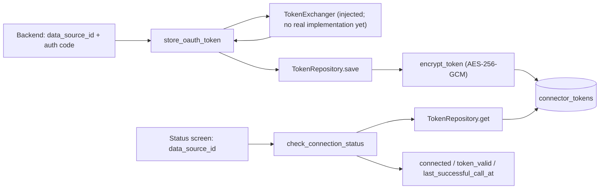

# CONN-02 — Implement OAuth Token Security and Connection Health

## 1. Overview

| Item | Value |
|---|---|
| Task | CONN-02 — Implement OAuth Token Security and Connection Health |
| Layer | Connector |
| Owner | Mohamed Hassan (reassigned from Youssef Halawa, the original assignee) |
| Status | **Implemented** at the token boundary — merged to `main` on 25 Aug 2026 (pull request #4); corrected on 21 Oct 2026 (pull request #30). Real provider token exchange is not implemented (Section 15) |
| Document type | Retroactive task document, written on 21 Oct 2026 for work merged before task documentation became mandatory |

CONN-02 delivered the Connector layer's OAuth token boundary in `sawakli.connectors.oauth`:

- `store_oauth_token()` exchanges an authorization code for tokens and stores them;
- `refresh_token()` swaps a stored refresh token for new tokens;
- `check_connection_status()` reports whether a data source is connected, without exposing a
  token.

Token values are encrypted with AES-256-GCM before storage in the `connector_tokens` table, and
`PostgresTokenRepository` reads and writes that table.

An OAuth *authorization code* is the short-lived code a provider such as Google returns to Sawakli
after a user approves access. The code is exchanged for an *access token* (used to call the
provider's API) and often a *refresh token* (used to obtain a new access token when the old one
expires). These tokens give access to a customer's advertising account, so INT-01 makes the
Connector layer their only owner.

To unblock the real repository, pull request #4 also carried the DATA-01 database schema into
Alembic. That schema remains DATA-01's deliverable (Step 6).

## 2. Scope

### In Scope

- Token functions in [`connectors/oauth/tokens.py`](../../apps/backend/src/sawakli/connectors/oauth/tokens.py).
- Encryption and key loading in [`connectors/oauth/crypto.py`](../../apps/backend/src/sawakli/connectors/oauth/crypto.py).
- Data types, error kinds and the `TokenRepository` and `TokenExchanger` protocols in
  [`connectors/oauth/models.py`](../../apps/backend/src/sawakli/connectors/oauth/models.py).
- `InMemoryTokenRepository` and `PostgresTokenRepository` in
  [`connectors/oauth/repository.py`](../../apps/backend/src/sawakli/connectors/oauth/repository.py).
- Package exports in [`connectors/oauth/__init__.py`](../../apps/backend/src/sawakli/connectors/oauth/__init__.py).
- `CONNECTOR_TOKEN_ENCRYPTION_KEY` placeholder and instructions in [`.env.example`](../../.env.example).
- 32 unit tests and 7 PostgreSQL integration tests at delivery; 6 unit tests added by the October
  correction (Section 13).
- Work carried in the same pull request to unblock the repository: Alembic migrations
  `0001`–`0009`, [`db/migration_utils.py`](../../apps/backend/src/sawakli/db/migration_utils.py),
  [`db/tables.py`](../../apps/backend/src/sawakli/db/tables.py), the PEP 561 `py.typed` marker and
  the matching `pyproject.toml` settings (Step 6).

### Out of Scope

- A real `TokenExchanger` that calls Google or Meta token endpoints. None exists in the repository.
  The first real provider read path is in CONN-03.
- The OAuth redirect and callback HTTP endpoints, and passing the code to the Connector (API-03).
- Scheduling refresh before expiry (WORK-03).
- Ownership of the database schema. The SQL comes from DATA-01, and the migrations are its
  deliverable; this task ported them without changing the SQL.
- Database login roles and the distribution of the encryption key to running processes
  ([ADR 0001](../adr/0001-runtime-boundaries-and-database-roles.md)).

## 3. Prerequisites

| Task / Contract | Why Required |
|---|---|
| INT-01 — Publish Canonical MVP Contract Pack | Defines the three functions and their errors (§2.7) and the `connector_tokens` table (§1.4). CONN-02 changed the functions' key from `org_id + provider` to `data_source_id`; INT-01 v1.1 (2 Oct 2026) adopted that change |
| DEV-01 — Establish Shared Monorepo, Docker Compose & CI Baseline | Package skeleton, PostgreSQL service and CI gates |
| DATA-01 — Finalize ERD, PostgreSQL Migrations, Roles & Indexes | Provides `data_sources`, `connector_tokens`, `provider_enum` and the `connector_role` grants |
| CONN-01 — Build Connector Package and CSV/Demo Parser | Provides the shared `ConnectorError` envelope ([CONN-01](CONN-01-csv-demo-parser.md)). Not listed on the Notion card |

Governing decisions and contracts:

- [ADR 0001 — Runtime Boundaries and Database Roles](../adr/0001-runtime-boundaries-and-database-roles.md):
  runtime identity, `connector_tokens` grants and encryption-key distribution.
- [RawResponse and Canonical Handoff Contract](../contracts/raw-response-canonical-handoff.md):
  credential failures are reported as `ConnectorError` and never persisted in payloads.

## 4. Architecture

```text
Backend OAuth callback (API-03, not merged) ── auth code only ──▶ store_oauth_token()
Backend or Worker (near expiry, not wired) ─────────────────────▶ refresh_token()
Backend connector-status screen (not wired) ────────────────────▶ check_connection_status()
                                                                      │
                                       TokenExchanger (injected, no real implementation yet)
                                       TokenRepository (injected)
                                                                      │
                                       PostgresTokenRepository ── encrypt/decrypt ──▶ connector_tokens
```

Ownership boundaries:

- **Connector (this task):** the only code that encrypts, decrypts, reads or writes token values.
  Plaintext exists only inside a repository call and in the `StoredToken` it returns to
  `tokens.py`. No function returns a token to its caller.
- **Backend:** passes only the authorization code and the `data_source_id`. It never receives a
  token (INT-01 §2.7 note; `tokens.py:1-7`).
- **Data / DATA-01:** owns the schema. `data_sources` is created by the Backend; the Connector
  only references it through the foreign key.

Dependencies are passed in as arguments (`repo`, `exchanger`). The functions open no database
connection and make no network call of their own, so they can be tested without either.

## 5. Step-by-Step Implementation Walkthrough

### Practical Outcome

Once a provider connection exists, the system can store its tokens encrypted, refresh them, and
answer "is this account still connected?" without any part of the application outside
`connectors/oauth/` seeing a token. Each connected account is identified by its `data_source_id`,
so one organization can connect two Google Ads accounts without their tokens overwriting each
other. A connection-status check on an unknown or expired source returns `connected=False` or
`token_valid=False` instead of an error, so a status screen can show a "reconnect" prompt.

Steps 1–6 are the original delivery (pull request #4). Step 7 records the post-merge corrections
made in pull request #30: a refresh keeps the stored refresh token when the provider sends no
new one, and the status check reports an undecryptable token as "reconnect" instead of raising.

What is not yet possible: no merged code calls these functions, and no real provider exchanger
exists. The boundary is implemented and tested with a test exchanger; end-to-end OAuth is not.

### Acceptance Criteria → Steps and Evidence

The criteria are the Definition of Done on the Notion card, quoted verbatim.

| Acceptance Criterion | Implementation Step(s) | Verification Evidence / Status |
|---|---|---|
| Authorization codes are exchanged through Connector. | 3, 4 | PASS at the boundary — `store_oauth_token` routes the code through the injected `TokenExchanger` (`test_store_success_saves_token_and_returns_true`, `test_store_invalid_auth_code`, `test_store_provider_unreachable`; Section 14). NOT RUN — exchange with a real provider: no `TokenExchanger` implementation exists (CONN-03) and no merged caller exists (API-03) |
| Token values are encrypted in canonical oauth_connections. | 1, 5 | PASS — the canonical table is `connector_tokens` (INT-01 §1.4; `oauth_connections` was the earlier Backend-report name). `test_tokens_are_actually_encrypted_at_rest` (unit) and `test_tokens_are_encrypted_at_rest_in_the_real_table` (PostgreSQL; PASS on 21 Oct 2026 and in `main` run 38951435772; NOT RUN in the August CI, Section 14) |
| Expiry refresh and health/reauth state work safely. | 3, 4, 7 | PASS — refresh and status tests, including expired, missing and non-expiring tokens, a refresh response without a refresh token, two such refreshes in a row, and undecryptable stored tokens (Section 14). The two gaps found on 21 Oct 2026 were corrected in Step 7. Database errors still propagate by design (Section 8) |
| No other layer can read plaintext token values. | 1, 3, 5 | Enforced by code ownership only: no public function returns a token. NOT RUN — no test asserts that another layer is refused. Database enforcement is not active: the `0007` grants restrict `connector_tokens` to `connector_role`, but every runtime process connects as the superuser ([ADR 0001](../adr/0001-runtime-boundaries-and-database-roles.md)) |

### Step 1 — Encrypt token values

- **What:** Provide authenticated encryption for token strings and a validated key loader.
- **Where:** [`crypto.py:23-91`](../../apps/backend/src/sawakli/connectors/oauth/crypto.py#L23-L91):
  `load_encryption_key`, `generate_encryption_key`, `encrypt_token`, `decrypt_token`.
- **How it works:** The key is read from `CONNECTOR_TOKEN_ENCRYPTION_KEY`. It must be standard
  base64 that decodes to exactly 32 bytes (AES-256). `encrypt_token` uses AES-GCM from the
  `cryptography` package (pinned `>=43,<44` in `pyproject.toml`) with a fresh random 12-byte
  nonce per call and stores `nonce || ciphertext` as one value. AES-GCM authenticates the data, so
  a wrong key or altered bytes fail to decrypt instead of producing garbage.
  `generate_encryption_key()` is a setup helper; it is not called at runtime.
- **Testing:** 11 tests in `test_crypto.py`: key present, missing, not base64, wrong length;
  round trip; ciphertext differs from plaintext; two encryptions differ; wrong key and tampered
  data raise `InvalidTag`; a too-short value raises `ValueError`. Status: PASS (Section 14).

### Step 2 — Define the data contracts

- **What:** Fix the shapes that cross the boundary and the injection points for storage and
  provider calls.
- **Where:** [`models.py:38-156`](../../apps/backend/src/sawakli/connectors/oauth/models.py#L38-L156).
- **How it works:** `Provider` mirrors PostgreSQL `provider_enum` exactly: `googleads`, `metaads`,
  `googleanalytics`, `csv_demo` (migration `0001`). `TokenErrorKind` has `invalid_auth_code`,
  `provider_unreachable` and `refresh_denied`, the INT-01 §2.7 set. `StoredToken` and
  `ExchangedToken` allow `refresh_token` and `expires_at` to be `None`, because the real columns
  are nullable. `ConnectionStatus` has `connected`, `token_valid` and `last_successful_call_at`.
  `TokenRepository` (`get`, `save`) and `TokenExchanger` (`exchange_auth_code`,
  `exchange_refresh_token`) are `typing.Protocol` interfaces. A real exchanger raises
  `InvalidAuthCodeError`, `ProviderUnreachableError` or `RefreshDeniedError` to signal provider
  failures.
- **Testing:** Covered through Steps 3–5. Status: PASS (Section 14).

### Step 3 — Implement the three token functions

- **What:** Implement INT-01 §2.7, keyed by `data_source_id`.
- **Where:** [`tokens.py:36-178`](../../apps/backend/src/sawakli/connectors/oauth/tokens.py#L36-L178).
- **How it works:**
  - `store_oauth_token` calls `exchanger.exchange_auth_code`. On success it saves a `StoredToken`
    with `last_refreshed_at` set to the current UTC time and returns `True`. Provider errors become
    `ConnectorError` with `invalid_auth_code` (not retryable) or `provider_unreachable`
    (retryable).
  - `refresh_token` loads the stored token. No row, or no stored refresh token, returns
    `refresh_denied` with "This connection needs to be set up again." Otherwise it calls
    `exchanger.exchange_refresh_token`, saves the result and returns the new `expires_at` (which
    may be `None`). Provider errors become `refresh_denied` or `provider_unreachable`.
  - `check_connection_status` returns `connected=False, token_valid=False` when no row exists.
    Otherwise `connected=True`, and `token_valid` is `True` when `expires_at` is `None` or later
    than now. `last_successful_call_at` is the `last_synced_at` value supplied by the caller; the
    function does not read `data_sources`.
- **Why `data_source_id`:** INT-01 v1.0 §2.7 keyed these functions by `org_id + provider`. One
  organization can connect several accounts on the same provider, and `org_id + provider` cannot
  tell them apart. `connector_tokens` is unique on `data_source_id`, which identifies one connected
  account. INT-01 v1.1 corrections 2 and 3 adopted this keying.
- **Testing:** 14 tests in `test_tokens.py` using `InMemoryTokenRepository` and a fake exchanger.
  Status: PASS (Section 14).

### Step 4 — Provide an in-memory repository

- **What:** A working `TokenRepository` without a database, used as the test double.
- **Where:** [`repository.py:34-87`](../../apps/backend/src/sawakli/connectors/oauth/repository.py#L34-L87),
  `InMemoryTokenRepository`.
- **How it works:** It holds only encrypted bytes in a dictionary keyed by `data_source_id`,
  encrypting on `save` and decrypting on `get`, the same pattern the PostgreSQL repository uses.
- **Testing:** 7 tests in `test_repository.py`: missing row, round trip, encryption at rest,
  overwrite, independent data sources, nullable refresh token, nullable expiry fields. Status: PASS
  (Section 14).

### Step 5 — Store tokens in PostgreSQL

- **What:** The real repository on `connector_tokens`.
- **Where:** [`repository.py:90-162`](../../apps/backend/src/sawakli/connectors/oauth/repository.py#L90-L162),
  `PostgresTokenRepository`; table handle
  [`db/tables.py:92-107`](../../apps/backend/src/sawakli/db/tables.py#L92-L107).
- **How it works:** The caller supplies a SQLAlchemy `Connection` and the key; the repository does
  not open, commit or close connections. `get` selects by `data_source_id` and decrypts. `save`
  encrypts, then runs `INSERT … ON CONFLICT (data_source_id) DO UPDATE`, so the first connection
  creates the row and later refreshes overwrite it. The table definition comes from migration
  `0005`: `UNIQUE (data_source_id)`, foreign key to `data_sources(id)` with `ON DELETE CASCADE`,
  `access_token_encrypted BYTEA NOT NULL`, and nullable `refresh_token_encrypted`, `expires_at`
  and `last_refreshed_at`
  ([`0005_connector_tables.py:40-54`](../../apps/backend/alembic/versions/0005_connector_tables.py#L40-L54)).
- **Testing:** 7 tests in
  [`test_postgres_repository.py`](../../apps/backend/tests/integration/connectors/oauth/test_postgres_repository.py),
  run only when `TEST_DATABASE_URL` is set: missing row, round trip, encrypted bytes in the real
  table, upsert keeps one row, nullable refresh token, nullable expiry fields, and cascade delete
  from `data_sources`. Status: PASS on 21 Oct 2026 and in current `main` CI; NOT RUN in the August
  CI (Section 14).

### Step 6 — Port the DATA-01 schema into Alembic (carried in the same pull request)

- **What:** Make `connector_tokens` and `data_sources` exist in every migrated database so that
  `PostgresTokenRepository` could be built and tested. This is DATA-01's schema, included in
  pull request #4 to unblock CONN-02. Schema ownership stays with DATA-01.
- **Where:** `apps/backend/alembic/versions/0001_extensions_and_enums.py` to
  `0009_seed_demo_data.py`; [`db/migration_utils.py`](../../apps/backend/src/sawakli/db/migration_utils.py);
  [`db/tables.py`](../../apps/backend/src/sawakli/db/tables.py); `src/sawakli/py.typed`;
  `pyproject.toml`.
- **How it works:** Each migration embeds one of Ahmed Ibrahim's nine DATA-01 SQL files unchanged
  (migration docstrings, for example `0005_connector_tables.py:1-8`) and runs it through
  `execute_sql_script`. That helper sends the script on the raw DBAPI cursor with no parameters.
  Through SQLAlchemy's normal path, psycopg treats `%` as a parameter placeholder and fails on text
  such as `'reduce budget by 20%'` (`migration_utils.py:1-12`). `db/tables.py` holds query-only
  SQLAlchemy Core table handles on a separate `MetaData`, so Alembic autogenerate never treats them
  as the schema source. `py.typed` and `[tool.setuptools.package-data]` mark the package as typed;
  `mypy_path = "src"` and `explicit_package_bases` let mypy resolve `sawakli.db.tables` from the
  connector package. A ruff `E501` exemption keeps the embedded SQL byte-for-byte.
- **Testing:** The August CI applied `alembic upgrade head` through `0009` successfully (Section 14).
  A downgrade was not part of that CI. The current CI runs an upgrade, downgrade, upgrade round
  trip, added later by QA-00.

### Step 7 — Post-merge corrections (October 2026)

- **What:** While this document was being written retroactively on 21 Oct 2026 (pull request
  #29), two behavior gaps were found with synthetic keys and tokens:
  1. **A refresh could erase the refresh token.** A provider's refresh response may omit the
     refresh token. `refresh_token()` saved the response as-is, so the stored refresh token became
     `NULL` and the next refresh returned `refresh_denied` ("needs to be set up again"), even though
     the original refresh token was still valid. A user would have been asked to reconnect for no
     reason.
  2. **The status check could raise.** If the encryption key changed or the stored bytes were
     altered or truncated, the repository's decrypt step raised `InvalidTag` or `ValueError`, and
     `check_connection_status()` raised with it. INT-01 §2.7 says this function "never errors"; a
     status screen should show "reconnect", not fail.

  The same review also corrected four stale code comments (no behavior change).
- **Where:** [`tokens.py`](../../apps/backend/src/sawakli/connectors/oauth/tokens.py),
  `refresh_token()` and `check_connection_status()`; docstrings in `models.py`, `crypto.py` and
  `tokens.py`; the `data_sources_table` comment in `db/tables.py`.
- **How it works:**
  1. In `refresh_token()` only, when the provider's response has no refresh token, the value saved
     is the existing stored refresh token (built with `dataclasses.replace`). When the provider does
     send a new refresh token, the new one is saved, so rotation still works. `store_oauth_token()`
     is unchanged: on a first connection, "no refresh token" correctly means none was issued.
  2. `check_connection_status()` now catches exactly the two exceptions that `decrypt_token` raises:
     `InvalidTag` (wrong key or altered bytes) and `ValueError` (data too short to hold a nonce). In
     that case it returns `connected=True, token_valid=False`, with `last_successful_call_at`
     passed through: a row exists, but its token is unusable, so the user must reconnect. It logs
     one warning that names only the `data_source_id` and the exception class. Database errors are
     not caught: "never errors" covers token states, not infrastructure failure, and the caller owns
     the connection and transaction.
  3. Comments: the `TokenRepository` and `tokens.py` docstrings now name `PostgresTokenRepository`
     instead of saying it will be added later; `decrypt_token` names `InvalidTag`; the
     `check_connection_status` docstring describes the behavior above; the `data_sources_table`
     comment no longer says `check_connection_status()` queries that table.

  No public signature, return type or error kind changed.
- **Testing:** New tests in `test_tokens.py`:
  `test_refresh_without_new_refresh_token_keeps_existing_one`,
  `test_two_refreshes_without_new_refresh_token_both_succeed`,
  `test_status_wrong_key_is_connected_but_invalid_and_does_not_raise`,
  `test_status_too_short_ciphertext_is_connected_but_invalid` and
  `test_status_decryption_failure_passes_through_last_synced_at` failed on the unfixed code and
  pass after the fix. `test_status_database_errors_still_propagate` records the database-error
  boundary. Rotation is covered by the existing `test_refresh_success_updates_stored_token`.
  Evidence: Section 14, "Post-merge corrections (21 Oct 2026)".

### Flow Diagram



## 6. Inputs

| Field / Input | Type | Required | Source | Description |
|---|---|---|---|---|
| `data_source_id` | `UUID` | Yes | Caller (Backend or Worker) | One connected account. The caller must confirm it belongs to the authenticated organization (Section 11) |
| `provider` | `Provider` | Yes for store and refresh | Caller | One of `googleads`, `metaads`, `googleanalytics`, `csv_demo`. Stored in the row and passed to the exchanger |
| `auth_code` | `str` | Yes for store | OAuth callback | Single-use authorization code. Passed to the exchanger only; never stored or logged by this module |
| `repo` | `TokenRepository` | Yes (keyword-only) | Caller | `PostgresTokenRepository` in production; `InMemoryTokenRepository` in tests |
| `exchanger` | `TokenExchanger` | Yes for store and refresh (keyword-only) | Caller | Provider client. No implementation exists in the repository |
| `last_synced_at` | `datetime \| None` | No (status only) | Caller, from `data_sources.last_synced_at` | Returned unchanged as `last_successful_call_at` |
| `CONNECTOR_TOKEN_ENCRYPTION_KEY` | env var, base64 | Yes to construct a repository | Process environment | Must decode to 32 bytes. The `.env.example` value `REPLACE_ME_WITH_GENERATED_KEY` is deliberately invalid |

## 7. Outputs

| Field / Output | Type | Nullable | Consumer | Description |
|---|---|---|---|---|
| `store_oauth_token` result | `bool \| ConnectorError` | No | Backend callback | `True` after the token is saved |
| `refresh_token` result | `datetime \| None \| ConnectorError` | Yes | Backend or Worker | New expiry; `None` when the provider gives none |
| `ConnectionStatus.connected` | `bool` | No | Backend status screen | `True` when a token row exists |
| `ConnectionStatus.token_valid` | `bool` | No | Backend status screen | `False` only when `expires_at` is in the past or no row exists |
| `ConnectionStatus.last_successful_call_at` | `datetime \| None` | Yes | Backend status screen | Echo of the caller's `last_synced_at` |
| `ConnectorError.kind` | `TokenErrorKind` | No | Backend, Worker | `invalid_auth_code`, `provider_unreachable` or `refresh_denied` |
| `ConnectorError.message` | `str` | No | Logs | Names the provider and `data_source_id`; never a token |
| `ConnectorError.user_message` | `str` | No | UI | Safe text, such as "Please reconnect." |
| `ConnectorError.retryable` | `bool` | No | Backend, Worker | `True` only for `provider_unreachable` |
| `connector_tokens` row | table row | — | Connector only | Encrypted tokens, `provider`, `expires_at`, `last_refreshed_at` |

## 8. Rules and Semantics

- **Keying:** one `connector_tokens` row per `data_source_id`. Saving again replaces the row.
- **Token validity:** `token_valid = expires_at is None or expires_at > now (UTC)`. A token with no
  known expiry counts as valid, because there is no evidence it has expired. A token that has
  expired is still `connected=True` with `token_valid=False`. A stored token that cannot be
  decrypted is also `connected=True` with `token_valid=False` (Step 7).
- **"Never errors" boundary:** `check_connection_status` never raises for a token state (missing,
  expired or undecryptable). Database errors propagate by design.
- **Missing values:** no row means not connected. A row without a refresh token cannot be
  refreshed; `refresh_token` returns `refresh_denied` and the user must reconnect.
- **Refresh result:** the new `access_token` and `expires_at` from the provider replace the stored
  values. A new refresh token replaces the stored one; if the refresh response contains no refresh
  token, the existing one is kept (Step 7).
- **Error mapping:** `InvalidAuthCodeError` → `invalid_auth_code`; `RefreshDeniedError`, no row or
  no refresh token → `refresh_denied`; `ProviderUnreachableError` → `provider_unreachable`
  (retryable). Other exceptions from an exchanger or repository are not caught.
- **Encryption:** every write uses a new random nonce, so the same token encrypts to different
  bytes each time. The nonce is stored as the first 12 bytes of the column value.
- **Duplicates:** prevented by `UNIQUE (data_source_id)` and the upsert.
- **Determinism:** `last_refreshed_at` and the validity check use the current time, and ciphertext
  is random by design. All other behavior is deterministic.

## 9. Public Interfaces

Exported from `sawakli.connectors.oauth` (`__init__.py:17-36`). Signatures as in the code:

```python
def store_oauth_token(
    data_source_id: UUID,
    provider: Provider,
    auth_code: str,
    *,
    repo: TokenRepository,
    exchanger: TokenExchanger,
) -> bool | ConnectorError: ...

def refresh_token(
    data_source_id: UUID,
    provider: Provider,
    *,
    repo: TokenRepository,
    exchanger: TokenExchanger,
) -> datetime | None | ConnectorError: ...

def check_connection_status(
    data_source_id: UUID,
    *,
    repo: TokenRepository,
    last_synced_at: datetime | None = None,
) -> ConnectionStatus: ...

class PostgresTokenRepository:
    def __init__(self, connection: Connection, encryption_key: bytes) -> None: ...

class InMemoryTokenRepository:
    def __init__(self, encryption_key: bytes) -> None: ...

def load_encryption_key(env: dict[str, str] | None = None) -> bytes: ...
def generate_encryption_key() -> str: ...
```

- **Side effects:** `store_oauth_token` and a successful `refresh_token` call the exchanger and
  write one row through the repository. `check_connection_status` reads one row.
  `PostgresTokenRepository.save` executes one upsert on the caller's connection and does not
  commit.
- **Errors raised, not returned:** `load_encryption_key` raises `EncryptionKeyError` for a
  missing, non-base64 or wrong-length key. Decryption with the wrong key or of altered data raises
  `cryptography.exceptions.InvalidTag`, and data too short to hold a nonce raises `ValueError`.
  `check_connection_status` catches both (Step 7); `refresh_token` does not. Database errors
  propagate from SQLAlchemy.
- `encrypt_token` and `decrypt_token` are module functions in `crypto.py`, not package exports.

## 10. Data Ownership

### Reads

- `connector_tokens` (one row by `data_source_id`).
- `CONNECTOR_TOKEN_ENCRYPTION_KEY` from the environment when the caller uses `load_encryption_key`.

### Writes

- `connector_tokens` (insert or update by `data_source_id`). The Connector layer owns this table
  exclusively (INT-01 §1.4; migration `0005` table comment).

### Must Never Read

- Token values from any table other than `connector_tokens`.
- Data belonging to another organization. The module has no organization filter of its own; scope
  comes only from the `data_source_id` the caller has already verified.

### Must Never Write

- `data_sources` (created by the Backend; status fields belong to the Data layer, INT-01 v1.1
  correction 1). The Connector holds only `SELECT` on it (`0007_security_roles_grants_rls.py:165`).
- Any table outside `connector_tokens`, and any log, response or payload with a token value.

## 11. Security

- **Tokens at rest:** encrypted with AES-256-GCM; the database holds only nonce and ciphertext.
  Verified against the real table by `test_tokens_are_encrypted_at_rest_in_the_real_table`.
- **Plaintext in memory:** plaintext exists inside repository calls and in `StoredToken` values
  that `tokens.py` uses internally. No public function returns a token. `ConnectorError` messages
  contain the provider name and `data_source_id`, not token values.
- **Encryption key:** read from `CONNECTOR_TOKEN_ENCRYPTION_KEY`; never hard-coded. Placeholder
  only in `.env.example`. A missing or malformed key fails fast with `EncryptionKeyError`. Changing
  the key makes existing rows unreadable (`InvalidTag`); there is no key rotation or key ID. The
  status check then reports `token_valid=False` and logs only the `data_source_id` and exception
  class (Step 7).
  [ADR 0001](../adr/0001-runtime-boundaries-and-database-roles.md) FU-07 records that Docker
  Compose passes the key to no process today and that the key goes to the API with API-03.
- **Database permissions:** migration `0007` grants `connector_tokens` only to `connector_role`
  and excludes it from `readonly_role` (`0007_security_roles_grants_rls.py:159-165,204`). These
  grants are not enforced at runtime yet, because the API, the Worker and the tests connect as the
  bootstrap superuser (ADR 0001, Context and FU-06, FU-09).
- **Organization isolation:** `connector_tokens` has no `organization_id` column. Every caller
  must check that the `data_source_id` belongs to the authenticated organization before calling,
  as the CSV upload route already does for CSV sources (`api/routes/connectors.py:97-99`). No
  cross-organization test exists for these functions, because no merged caller exists.
- **Trust boundary:** the Backend hands over only the authorization code (INT-01 §2.7 note). The
  code is passed to the exchanger and is not stored.

## 12. Error and Edge-Case Behavior

| Case | Expected Behavior |
|---|---|
| Missing input | No stored token: `refresh_token` returns `refresh_denied`; `check_connection_status` returns `connected=False, token_valid=False` |
| Malformed input | Provider rejects the code: `invalid_auth_code` (not retryable). Malformed or missing key: `EncryptionKeyError` from `load_encryption_key` |
| Zero values | N/A — no numeric inputs |
| Insufficient data | Stored row without a refresh token: `refresh_denied`. Row without `expires_at`: `token_valid=True` |
| Duplicate records | Upsert on `data_source_id` keeps one row |
| Database failure | SQLAlchemy exceptions propagate to the caller, including from `check_connection_status`; the caller owns the transaction |
| Provider or API failure | `ProviderUnreachableError` → `provider_unreachable` (retryable); `RefreshDeniedError` → `refresh_denied` (reconnect). Any other exchanger exception, such as a raw `TimeoutError`, propagates (observed on 21 Oct 2026) |
| Timeout | No timeout is applied in this module. A real exchanger must apply one and raise `ProviderUnreachableError` |
| Cancellation | N/A — calls are synchronous; no cancellation hook |
| Wrong key or altered ciphertext | `decrypt_token` raises `InvalidTag` (`ValueError` if too short). `check_connection_status` returns `connected=True, token_valid=False` and logs a warning (Step 7; before 21 Oct 2026 it raised). `refresh_token` still raises; a new `store_oauth_token` overwrites the row and recovers |
| Refresh response without a refresh token | The existing stored refresh token is kept, so later refreshes still work (Step 7; before 21 Oct 2026 it was cleared) |
| Data source deleted | The `connector_tokens` row is deleted by `ON DELETE CASCADE` |

## 13. Testing

### Unit Tests

No database or network; 38 tests in `tests/unit/connectors/oauth/` (32 from the original delivery,
6 added in Step 7):

- [`test_crypto.py`](../../apps/backend/tests/unit/connectors/oauth/test_crypto.py) (11): key
  loading succeeds and fails for missing, non-base64 and wrong-length keys; generated keys load;
  round trip; ciphertext hides the plaintext; nonces differ; wrong key and tampering are detected;
  short values are rejected.
- [`test_repository.py`](../../apps/backend/tests/unit/connectors/oauth/test_repository.py) (7):
  the in-memory repository stores only ciphertext, round-trips nullable fields, overwrites by
  `data_source_id`, and keeps data sources independent.
- [`test_tokens.py`](../../apps/backend/tests/unit/connectors/oauth/test_tokens.py) (20): store
  success and both store errors; refresh success, no row, no refresh token, provider denial and
  provider outage; status for no row, valid, expired and non-expiring tokens; status does not raise
  for an unknown data source; `last_synced_at` is passed through. Added in Step 7: a refresh without
  a new refresh token keeps the old one, and two such refreshes in a row both succeed; status with a
  wrong key or too-short stored data returns `connected=True, token_valid=False` without raising,
  passes `last_synced_at` through, and logs no token material; database errors still propagate.

### Integration Tests

[`tests/integration/connectors/oauth/test_postgres_repository.py`](../../apps/backend/tests/integration/connectors/oauth/test_postgres_repository.py)
(7) runs `PostgresTokenRepository` against a migrated PostgreSQL database. The tests insert their
own `organizations` and `data_sources` rows with raw SQL, then check encryption in the real table,
the upsert, nullable columns and the cascade delete. They skip when `TEST_DATABASE_URL` is unset.

### E2E Impact

None today: no merged endpoint or job calls the token functions. API-03 and CONN-03 will need an
end-to-end test from OAuth callback to stored token, including a cross-organization check.

## 14. Verification

### Verified at merge (August 2026, historical CI)

Pull request #4 head commit `7d2d08a`, workflow "Sawakli AI CI", run
[32873121364](https://github.com/elfaroukomaradmission-a11y/Sawakli-AI/actions/runs/32873121364)
(event `pull_request`, conclusion `success`):

| Check | Result | Evidence from the run log |
|---|---|---|
| `ruff check .` | PASS | "All checks passed!" |
| `ruff format --check .` | PASS | "74 files already formatted" |
| `mypy src` (`strict = true`) | PASS | "Success: no issues found in 46 source files" |
| `pytest` — 48 tests not needing a database | PASS | "collected 55 items", "48 passed, 7 skipped" |
| `pytest` — 7 PostgreSQL repository tests | NOT RUN — `TEST_DATABASE_URL` was not set in CI; the variable does not appear in the run log or in `ci.yml` at `c4277d7` |
| `alembic upgrade head` (Verify migrations step, `0001`–`0009`) | PASS | Log shows each upgrade from `0001_extensions_and_enums` onward |
| Frontend and Integration jobs | PASS | Both jobs `success` |

Merge commit `c4277d7` on `main`: push run
[32873316056](https://github.com/elfaroukomaradmission-a11y/Sawakli-AI/actions/runs/32873316056),
conclusion `success`.

The 7 skipped tests were recorded as finding D-15 in the
[TRK-06 register](../testing/TRK-06-integrated-baseline-register.md). QA-00 fixed this: `ci.yml`
now builds a fresh test database with `scripts/integration_harness.py fresh-db`, sets
`TEST_DATABASE_URL`, and fails the job if any test is skipped (`ci.yml:90-102`;
[QA-00](../testing/QA-00-contract-validators-and-integration-harness.md)).

### Re-run for this document (21 Oct 2026)

Environment: Windows 10, Python 3.12.10 (`tmp/venv`), ruff 0.16.9, mypy 1.20.2, Docker 29.8.1,
branch `docs/conn-01-02-task-docs` at `origin/main` `57bb11e`. Commands run from `apps/backend`:

```bash
ruff check .
ruff format --check .
mypy src
pytest tests/unit/connectors -v
# throwaway container: postgres:18 (PostgreSQL 18.6) on port 5441, removed afterwards
TEST_DATABASE_URL=postgresql+psycopg://postgres:<throwaway>@localhost:5441/sawakli_integration_test \
  python ../../scripts/integration_harness.py fresh-db TEST_DATABASE_URL
TEST_DATABASE_URL=<same> pytest tests/integration/connectors -v
```

| Check | Result |
|---|---|
| `ruff check .` | PASS — "All checks passed!" |
| `ruff format --check .` | PASS — "160 files already formatted" |
| `mypy src` | PASS — "Success: no issues found in 90 source files" |
| `pytest tests/unit/connectors -v` | PASS — 46 passed (32 of them CONN-02 tests) |
| `integration_harness.py fresh-db` | PASS — database recreated and migrated to head |
| `pytest tests/integration/connectors -v` | PASS — 7 passed, 0 skipped |

Current `main` CI: run
[38951435772](https://github.com/elfaroukomaradmission-a11y/Sawakli-AI/actions/runs/38951435772)
on `57bb11e` — PASS. Its Tests step shows
`tests/integration/connectors/oauth/test_postgres_repository.py .......`, "296 passed" and
"skipped tests: 0".

### Code unchanged from delivery until the October correction

Before pull request #30, `git diff c4277d7 origin/main` on `connectors/oauth/`, `connectors/errors.py`, both connector test
trees, `db/migration_utils.py` and migrations `0001`–`0009` is empty. `db/tables.py` has since
gained tables from other tasks; its `connector_tokens` and `data_sources` definitions are
unchanged.

### Post-merge corrections (21 Oct 2026)

Branch `fix/conn-01-02-hardening`; fix commits `783f43e` (refresh token) and `f2c1669` (status
check), comment commit `3f9934a`, test commit `74c087b`; same environment as the re-run above.

Before the fix, the new tests were run against the unfixed code:

```text
pytest tests/unit/connectors/oauth/test_tokens.py -k without_new_refresh_token
FAILED test_refresh_without_new_refresh_token_keeps_existing_one
  AssertionError: assert None == 'original-refresh'
FAILED test_two_refreshes_without_new_refresh_token_both_succeed
  second refresh returned ConnectorError(kind=refresh_denied,
  message='No refresh token stored for data_source_id=...')
2 failed

pytest tests/unit/connectors/oauth/test_tokens.py -k "wrong_key or too_short or decryption"
FAILED test_status_wrong_key_is_connected_but_invalid_and_does_not_raise
  cryptography.exceptions.InvalidTag
FAILED test_status_too_short_ciphertext_is_connected_but_invalid
  ValueError: Encrypted blob is too short to contain a nonce.
FAILED test_status_decryption_failure_passes_through_last_synced_at
  cryptography.exceptions.InvalidTag
3 failed
```

| Check | Result |
|---|---|
| New refresh-token tests before the fix | FAIL — 2 failed, for the reason above (expected) |
| New status-check tests before the fix | FAIL — 3 failed, for the reason above (expected) |
| `pytest tests/unit/connectors/oauth/test_tokens.py -v` after both fixes | PASS — 20 passed |
| `ruff check .`, `ruff format --check .`, `mypy src` at `74c087b` | PASS — "All checks passed!", "160 files already formatted", "Success: no issues found in 90 source files" |
| Full `pytest -rs` at `74c087b` against a throwaway `postgres:18` container prepared with `integration_harness.py fresh-db TEST_DATABASE_URL`, with the CI job's environment variables | PASS — 305 passed, 0 skipped, 0 failed |
| Pull request #30 CI | NOT RUN — the pull request did not exist when this commit was written; result added in a later commit |

The first full-suite run after the fixes had 1 failure: the log assertion in
`test_status_wrong_key_is_connected_but_invalid_and_does_not_raise` saw an empty log, because
database fixtures run Alembic in-process and Alembic's logging setup disables existing loggers.
Commit `74c087b` re-enables the `tokens` logger for that test only; the status behavior itself
passed in that run.

`test_status_database_errors_still_propagate` was added with the status-check fix to record the
database-error boundary. It was not part of the before-fix run; the unfixed code also let
that error through, so the test would have passed there too.

## 15. Known Limitations

- **No real provider exchange.** No `TokenExchanger` implementation exists, so no real
  authorization code can be exchanged yet. This is CONN-03's work.
- **No merged caller.** Nothing on `main` calls `store_oauth_token`, `refresh_token` or
  `check_connection_status`. The OAuth callback was in pull request #18 (API-03), which was closed
  unmerged on 17 Oct 2026.
- **`check_connection_status` raises on database errors by design.** It never raises for a token
  state (missing, expired or undecryptable), but database errors propagate to the caller, which
  owns the connection and transaction.
- **`refresh_token` raises on an undecryptable stored token.** `InvalidTag` or `ValueError` from the
  repository is not mapped to a `ConnectorError`. The status check reports this state as
  `token_valid=False`, and reconnecting through `store_oauth_token` overwrites the row.
- **Database grants are not enforced at runtime.** All processes use the superuser identity
  ([ADR 0001](../adr/0001-runtime-boundaries-and-database-roles.md)); the integration tests also
  connect as the superuser and cannot prove the `connector_role` grants (ADR 0001 FU-09).
- **The encryption key is not deployed.** No process receives `CONNECTOR_TOKEN_ENCRYPTION_KEY` in
  Compose (ADR 0001 FU-07). There is no key rotation.
- **Organization scope relies on the caller.** `connector_tokens` has no `organization_id`, and
  no cross-organization test exists for these functions.
- **The `connector_tokens` table comment still reads "PROVISIONAL"** (migration `0005`), although
  INT-01 v1.1 records the token-storage ownership and `connector_tokens` schema questions as
  decided.

## 16. Follow-Up Tasks

- `CONN-03` — Youssef Halawa — first real provider read path; needs a `TokenExchanger`
  implementation (Prerequisites: CONN-02, API-03).
- `API-03` — Ahmed Ibrahem — OAuth callback that passes the code to `store_oauth_token`, and
  connection status for the UI; also carries the encryption key to the API (ADR 0001 FU-07).
- `WORK-03` — El-Farouk Omar — schedule `refresh_token` before expiry.
- ADR 0001 FU-06 and FU-09 — runtime logins and tests that prove `connector_tokens` grants
  (owners as listed in the ADR).
- Unassigned — the "PROVISIONAL" comment on `connector_tokens` (migration `0005`). Applied
  migrations are not edited, and the schema belongs to DATA-01, so any change needs the DATA-01
  owner.
- Unassigned — decide whether `refresh_token` should map an undecryptable stored token to a
  `ConnectorError` (Section 15). Changing it is a contract-visible behavior change.

## 17. References and Evidence

- Notion task: `📋 Tasks/CONN-02 — Implement OAuth Token Security and Conne 3bc7de83a91b81c193e1e49292ab4c60.md`
  in the Notion export `all tasks and files as of 14 oct.zip` (Base Points 5; Window W2, 22–28 Aug
  2026; due 27 Aug 2026; completed 25 Aug 2026, "On time"; source trace "Connector
  CL-01/CL-03/CL-06/CL-09; Phase-1 token resolution")
- Pull request: [#4](https://github.com/elfaroukomaradmission-a11y/Sawakli-AI/pull/4), branch
  `conn-01-csv-parser` (reused after #1) → `main`, 26 files, +4046 / −2, merged
  2026-08-25 16:39:56 UTC (20:39:56 UTC+4), merge commit `c4277d7`. Commits:
  `75d41e0` "CONN-02: wire real Postgres repository, fix nullable fields from Ahmed's actual
  schema" (16:27:26 UTC) and `7d2d08a` "CONN-02: document CONNECTOR_TOKEN_ENCRYPTION_KEY in
  .env.example" (16:33:28 UTC)
- Post-merge correction: [#30](https://github.com/elfaroukomaradmission-a11y/Sawakli-AI/pull/30),
  branch `fix/conn-01-02-hardening` (Step 7). This document was first added in
  [#29](https://github.com/elfaroukomaradmission-a11y/Sawakli-AI/pull/29)
- Canonical contracts: [RawResponse and Canonical Handoff Contract](../contracts/raw-response-canonical-handoff.md);
  `INT-01_Canonical_MVP_Contract_Pack.pdf` (v1.0, §1.4, §2.7, §3) and
  `INT-01_Canonical_MVP_Contract_Pack_v1.1.pdf` (page 12, corrections 1–4)
- ADRs: [ADR 0001 — Runtime Boundaries and Database Roles](../adr/0001-runtime-boundaries-and-database-roles.md)
- Related technical documentation: [CONN-01](CONN-01-csv-demo-parser.md),
  [ARCH-01](../architecture/ARCH-01-runtime-boundaries-and-database-roles.md),
  [TRK-06 register](../testing/TRK-06-integrated-baseline-register.md) (§13.4 CONN-02 row; D-15),
  [QA-00](../testing/QA-00-contract-validators-and-integration-harness.md)
- Historical material (context only): `Sawakli_AI_Weekly_Update_CONN01_CONN02_API04.pdf`
  (pages 4–5), `Connector_Layer_Report.pdf` (CL-01, CL-03, CL-06, CL-09), `Tasks.pdf`
- Test or CI evidence: runs
  [32873121364](https://github.com/elfaroukomaradmission-a11y/Sawakli-AI/actions/runs/32873121364),
  [32873316056](https://github.com/elfaroukomaradmission-a11y/Sawakli-AI/actions/runs/32873316056),
  [38951435772](https://github.com/elfaroukomaradmission-a11y/Sawakli-AI/actions/runs/38951435772);
  local re-run on 21 Oct 2026 (Section 14); pull request #30 CI (added in a later commit)
