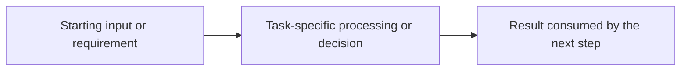

# TASK-ID — Task Name

<!--
Copy this file to docs/<layer>/<TASK-ID>-<short-name>.md.
Replace every placeholder. Use "N/A — <reason>" where a section does not apply.
Link to canonical contracts instead of duplicating them.
-->

## 1. Overview

Explain:

- what the component does;
- why it exists; and
- where it fits in Sawakli AI.

## 2. Scope

### In Scope

- ...

### Out of Scope

- ...

Explicitly identify responsibilities belonging to other tasks or layers.

## 3. Prerequisites

| Task / Contract | Why Required |
|---|---|
| ... | ... |

List relevant ADRs and canonical contracts.

## 4. Architecture

Explain the component's position in the system.

Use a simple flow when useful:

```text
Input
↓
Component
↓
Output
```

Clearly document ownership boundaries.

## 5. Step-by-Step Implementation Walkthrough

### Practical Outcome

Explain in plain language what someone can do or understand once this task is complete and why
that outcome matters. Use concrete examples where helpful; explain unfamiliar terms.

For completed work, describe the actual implementation, verified against current repository code,
tests, canonical contracts, and accepted ADRs. Clearly label proposed, unfinished, or deferred steps;
do not present plans as working behavior. Use historical guidance for writing style, not as proof
of current technical behavior.

### Acceptance Criteria → Steps and Evidence

Map every acceptance criterion from the approved task to the steps that deliver it and the evidence
that verifies it. Identify gaps explicitly rather than implying that a planned check has passed.

| Acceptance Criterion | Implementation Step(s) | Verification Evidence / Status |
|---|---|---|
| <Required outcome> | <Step number(s)> | <Test, command, or review evidence; actual status or NOT RUN — reason> |

### Step 1 — <Task-Specific Action>

Repeat this step structure in the order that best explains the task. Replace generic titles with
concrete actions and use as many steps as needed to connect the starting point to the outcome.

- **What:** Explain what this step accomplishes and why it matters to the task.
- **Where:** Point to the relevant file paths and, where applicable, functions, classes, endpoints,
  or configuration. For architecture or QA work, identify the relevant decision, contract,
  procedure, test scenario, or evidence artifact instead of inventing code details.
- **How it works:** Walk through the actions and data or decision flow. Explain what arrives from
  preceding steps, what changes here, and what the next step consumes. Include relevant ownership
  boundaries and failure paths; link to canonical definitions rather than copying them.
- **Testing:** Identify the relevant tests, commands, or review procedure and describe the expected
  behavior. Label expected outcomes separately from checks actually executed. For actual results,
  use `PASS`, `FAIL`, or `NOT RUN — <reason>` and link to the Verification section for the command,
  date, environment, and observed evidence. A suggested command is not an executed check.

Adapt the steps to AI, API, UI, connectors, data, workers, architecture, or QA tasks. Include only
details that help explain this task; do not require functions or endpoints for non-code work.

### Flow Diagram (When Useful)

Include a small Mermaid diagram when it materially clarifies how the steps connect. Replace or
remove this illustrative flow to match the task; distinguish proposed handoffs from implemented
ones. Omit the diagram when the prose already makes the flow clear.



## 6. Inputs

| Field / Input | Type | Required | Source | Description |
|---|---|---|---|---|
| ... | ... | ... | ... | ... |

Include validation, organization scope, nullable behavior, and source.

## 7. Outputs

| Field / Output | Type | Nullable | Consumer | Description |
|---|---|---|---|---|
| ... | ... | ... | ... | ... |

Do not document fields that do not exist.

## 8. Rules and Semantics

Document formulas, algorithms, calculations, ordering rules, status transitions, and other
meaningful behavior.

Clearly define:

- missing values;
- zero denominators;
- insufficient data;
- duplicates;
- ordering; and
- deterministic behavior where applicable.

Where a canonical contract exists, link to it instead of redefining it.

## 9. Public Interfaces

Document only meaningful externally consumed interfaces:

- functions;
- classes;
- REST endpoints;
- events;
- jobs; and
- database reads and writes.

For each interface, explain its input, output, errors, and side effects. Do not document every
private helper.

## 10. Data Ownership

### Reads

- ...

### Writes

- ...

### Must Never Read

- ...

### Must Never Write

- ...

This section is mandatory.

## 11. Security

Document applicable organization isolation, authentication, authorization, secrets, OAuth tokens,
sensitive fields, database permissions, and trust boundaries.

If there are no special security implications, explicitly say so.

## 12. Error and Edge-Case Behavior

| Case | Expected Behavior |
|---|---|
| Missing input | ... |
| Malformed input | ... |
| Zero values | ... |
| Insufficient data | ... |
| Duplicate records | ... |
| Database failure | ... |
| Provider or API failure | ... |
| Timeout | ... |
| Cancellation | ... |

Remove irrelevant example rows only after recording why the case cannot apply.

## 13. Testing

### Unit Tests

- ...

### Integration Tests

- ...

### E2E Impact

- ...

Document acceptance behavior, not merely filenames.

## 14. Verification

Commands executed:

```bash
...
```

Results:

- Command, date, environment, and outcome: ...
- CI run or pull request evidence: ...

Do not claim checks that were not run. Explain any omitted or failed verification.

## 15. Known Limitations

- ...

Use `None known` only after considering production, data, security, and operational limits.

## 16. Follow-Up Tasks

- `TASK-ID` — owner — reason or dependency

Use `None` when no follow-up work is required. Do not hide required completion work here.

## 17. References and Evidence

- Notion task: ...
- Pull request: ...
- Canonical contracts: ...
- ADRs: ...
- Related technical documentation: ...
- Test or CI evidence: ...
