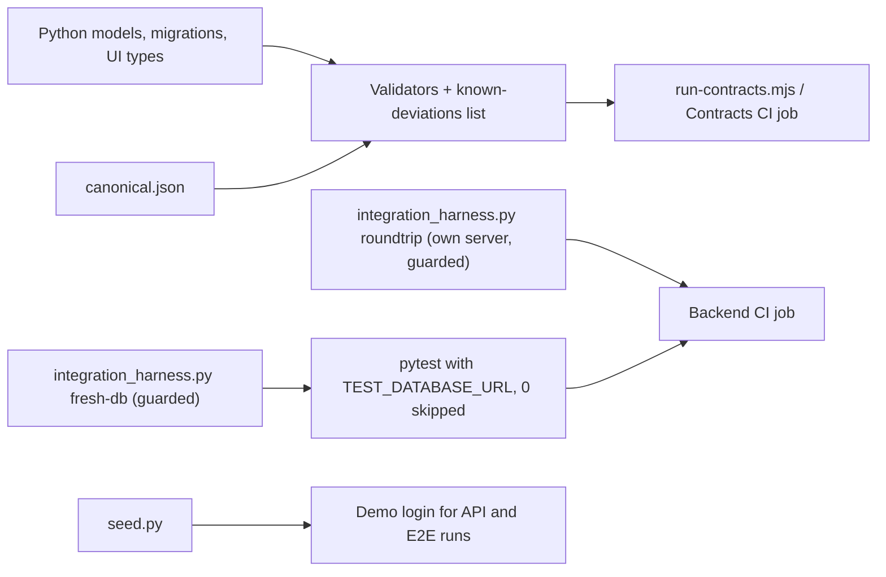

# QA-00 — Complete Contract Validators and Integration CI Harness

## 1. Overview

QA-00 turns the QA-01 contract fixtures into checks that fail on a genuine model mismatch and adds a
reproducible integration harness that runs identically on a developer machine and in CI.

It closes the following TRK-06 findings
([TRK-06 register](TRK-06-integrated-baseline-register.md)):

- the Backend and AI contract validators were placeholders that always exited 0;
- no CI job ran the contract validators;
- the deliberate-mismatch test exercised only the UI validator and edited the real
  `canonical.json` in place;
- nine real-PostgreSQL tests were skipped on every CI run because `TEST_DATABASE_URL` was never
  set;
- the CI migration step ran after the tests had already migrated, so it verified nothing, and
  downgrades were never exercised;
- no login existed for the Nour Fashion Co. demo organization; `tests/fixtures/seed.py` was a
  placeholder.

Status: **Implemented**. Validators, negative tests, root runner, harness and seed are verified
locally (Section 14). CI results are recorded against the pull request head commit in the pull
request.

## 2. Scope

### In Scope

- Real Backend and AI contract validators that statically read Python models and compare them with
  [`tests/contracts/canonical.json`](../../tests/contracts/canonical.json).
- DB validator extension: enum values added by `ALTER TYPE ... ADD VALUE` are now recognised.
- A reviewed allowlist of known deviations on `main`
  ([`tests/contracts/known-deviations.json`](../../tests/contracts/known-deviations.json)).
- Negative tests for every validator and for the allowlist, run on temporary copies only.
- One root command for all contract checks and a `Contracts` CI job.
- The shared integration environment: fresh migrated test databases, `TEST_DATABASE_URL`, and a
  migration round-trip on a separate fresh PostgreSQL server, locally and in CI.
- An idempotent demo-login seed for Nour Fashion Co. with a test.
- The [release and demo checklist](release-checklist.md).

### Out of Scope

- Changing another layer's models, routes, dataclasses or UI types to make a validator pass. Real
  mismatches are recorded with owners (Section 8.4), not fixed.
- Editing `canonical.json`. Adding `ERROR` to `job_status_enum` is an INT-01 contract decision.
- The web API client, real browser login and any UI change (ARCH-06, UI-04).
- A committed browser E2E suite (QA-04).
- Runtime database logins, grants and RLS proofs (ADR 0001 FU-01 to FU-10; QA-05 via FU-09).
- `verify_int01_schema()` 23-vs-24, duplicate `jobs` indexes, legacy root folders (DATA-01,
  WORK-02, FU-11).
- Dependency upgrades or pinning, including the passlib/bcrypt warning (follow-up).

## 3. Prerequisites

| Task / Contract | Why Required |
|---|---|
| TRK-06 | Baseline register that lists the gaps this task closes |
| QA-01 | Owns the original fixtures: `canonical.json`, DB/UI validators, deliberate-mismatch test |
| INT-01 | Canonical contract pack that `canonical.json` encodes |
| [ADR 0001](../adr/0001-runtime-boundaries-and-database-roles.md) | Database roles created by migration 0007, relevant to the round-trip (Section 8.6) and FU-09 |
| [RawResponse and Canonical Handoff Contract](../contracts/raw-response-canonical-handoff.md) | Ownership and semantics blocks carried in `canonical.json` |
| API-01, API-04, WORK-02, AI-03, AI-04 | Models, enums and migrations the validators compare |

## 4. Architecture

```text
tests/contracts/canonical.json  (owned fixture, never modified by any check)
        |
        +-- validate-db-schema.mjs ------ alembic/versions/*.py (regex; CREATE TYPE + ALTER TYPE ADD VALUE)
        +-- validate-ui-types.mjs ------- apps/web/src/types/*.ts (regex)
        +-- validate-backend-models.mjs --+
        +-- validate-ai-schemas.mjs ------+-- contract-lib.mjs
                                          |      +-- extract_python_models.py  (python -I, stdlib ast, no app import)
                                          |      +-- known-deviations.json      (reviewed allowlist)
        test-deliberate-mismatch.mjs -----+-- runs every validator on tampered temp copies
        scripts/run-contracts.mjs -------- runs all five, prints a PASS/FAIL table, writes the CI job summary

scripts/integration_harness.py
        fresh-db  -> drop/create *_test databases, alembic upgrade head
        roundtrip -> upgrade head -> downgrade base -> upgrade head on a fresh server

apps/backend/tests/fixtures/seed.py  -> demo user + organization_members row for Nour Fashion Co.
```

All new code is QA-owned test tooling. It reads application source and migrations; the only
application data the seed writes is the demo user and its membership. The seed's test fixture also
re-inserts the Nour Fashion Co. organization row in the test database when an earlier test deleted
it (Section 8.6).

## 5. Step-by-Step Implementation Walkthrough

### Practical Outcome

Before QA-00, two of the five contract checks only printed `PENDING` and always passed, so nobody
could tell whether the Backend and AI code still matched the shared contract
([`canonical.json`](../../tests/contracts/canonical.json)). Nine database tests never ran in CI, and
there was no login for the demo company.

After QA-00, anyone can run one command, `node scripts/run-contracts.mjs`, and get a PASS/FAIL
answer for every layer. CI runs the same command on every pull request as the `Contracts` check.
A "contract" here is the agreed list of tables, fields, types and allowed values that every layer
must follow; a "contract validator" reads one layer's code and reports anything that differs.
The integration harness gives every developer and CI the same freshly migrated test databases,
runs the previously skipped database tests, fails if any test is skipped, and proves the
migrations can be applied, removed and applied again. The demo-login seed creates a known login for
Nour Fashion Co., so API-level demo and E2E runs can sign in against real seeded data.

All steps below are **Implemented**. Results are recorded in Section 14.

### Acceptance Criteria → Steps and Evidence

| Acceptance Criterion | Implementation Step(s) | Verification Evidence / Status |
|---|---|---|
| Replace Backend/AI PENDING success scripts with checks that fail on a genuine model mismatch | 1, 2, 3, 4, 5, 6 | PASS — AI validator exits 1 on `main` (16 differences, commit `dea1c3c`); 9 reviewed deviations; negative suite 23/23 (Section 14) |
| Run root contract commands in CI against owned fixtures and report commands/results | 7 | PASS — `Contracts` job writes the command/result table to the job summary (CI runs in Section 14) |
| Publish shared integration environment | 8, 9, 10 | PASS — `fresh-db`, `TEST_DATABASE_URL`, zero-skip rule, round-trip on its own server (Section 14) |
| Publish browser E2E seed | 11 | PASS at API level (login and `/me` return Nour Fashion Co.). Browser login: NOT RUN — the web login is still a mock (ARCH-06, UI-04) |
| Publish release checklist | 12 | PASS — [release checklist](release-checklist.md) published; it is executed per release, not in this task |
| Entry contract: create one failing validator first | 1 | PASS — first commit `dea1c3c` contains the AI validator failing on `main` |
| Record reproducible integrated tests and independent review | 8, 9, 10, 12 | PASS — fresh-clone run and CI (Section 14); two independent agent reviews, all findings fixed. Human review: NOT RUN — requested on pull request #26, awaiting reviewers |

### Step 1 — Create the first failing validator (red first)

- **What:** Replace the always-passing AI placeholder with a real check and show it failing on
  `main` before anything is excused. This is the task's entry contract and proves the check can
  see real problems.
- **Where:** [`tests/contracts/validate-ai-schemas.mjs`](../../tests/contracts/validate-ai-schemas.mjs)
  as first committed in `dea1c3c`, with an empty allowlist.
- **How it works:** The validator only states which Python class corresponds to which contract
  table (`ForecastRecord` → `forecasts`, `Recommendation` → `recommendations`, `AnomalySignal` →
  `anomalies`) and compares them field by field. With no declarations it reported 16 differences:
  one genuine mismatch (`ForecastRecord.value` can be empty but the column is `NOT NULL`), seven
  fields that only exist once AI-06 saves a row, three in-memory-only fields and five columns
  outside the read-only `AnomalySignal` view (Section 8.3). Steps 3 and 5 then declare or list each
  one explicitly.
- **Testing:** Expected: exit 1 on `main` without declarations. Actual: PASS — exit 1 with 16
  differences (Section 14).

### Step 2 — Read Python models without running the app

- **What:** Give the validators a safe way to see the Backend and AI model definitions.
- **Where:** [`tests/contracts/extract_python_models.py`](../../tests/contracts/extract_python_models.py).
- **How it works:** The script parses source files with Python's built-in `ast` module, run as
  `python -I`, so no application code is imported and nothing needs installing. It prints JSON with
  each Pydantic model or dataclass and its fields (type text and whether a default exists), each
  enum and `Literal` alias with its values, and any construct it cannot interpret safely (extra
  base classes, aliases, `exclude=`, alias generators, non-`ConfigDict` `model_config`, nested
  `class Config`, computed fields, serializers). Non-string enum values become markers that never
  match. If a file cannot be read or parsed it exits 1, and the validator fails.
- **Testing:** Covered by the Python-side negative cases (Step 6). Actual: PASS (Section 14).

### Step 3 — Compare models with the contract (Backend and AI mappings)

- **What:** Turn the extracted models into a field-by-field comparison with clear, reviewed
  exceptions.
- **Where:** [`tests/contracts/contract-lib.mjs`](../../tests/contracts/contract-lib.mjs) (shared
  logic), [`validate-backend-models.mjs`](../../tests/contracts/validate-backend-models.mjs) and
  [`validate-ai-schemas.mjs`](../../tests/contracts/validate-ai-schemas.mjs) (mappings).
- **How it works:** Each mapping names a model, its contract table and any intentional difference
  with a reason: a rename (`job_id` → `id`), a column the API does not expose, a field that only
  exists in memory, or a field that may be optional. Everything else must match: every contract
  field present, compatible types, no optional value where the column is `NOT NULL`, and enum
  values identical in both directions. A declaration that stops matching the code fails as
  `stale_declaration`; a missing class fails as `model_not_found`. The rules are in Section 8.1
  and the mapping tables in Section 8.2.
- **Testing:** PASS on the real code with 9 accepted deviations; Python-side and contract-side
  negative cases fail as required (Section 14).

### Step 4 — Teach the DB validator about added enum values

- **What:** Make the existing QA-01 DB validator see enum values added after the table was created.
- **Where:** [`tests/contracts/validate-db-schema.mjs`](../../tests/contracts/validate-db-schema.mjs).
- **How it works:** Besides `CREATE TYPE`, it now reads `ALTER TYPE ... ADD VALUE`, including quoted
  and schema-qualified type names. This is how it found that migration `0011` added `ERROR` to
  `job_status_enum` without a contract update. Each DB finding now carries its own exact key, so
  one allowlist entry can only ever accept that one finding.
- **Testing:** PASS — exits 1 on `main` without an allowlist entry; the migration-side negative
  case fails as required (Section 14).

### Step 5 — Keep known problems in one reviewed list

- **What:** Record the real mismatches found on `main` without changing other layers' code and
  without weakening the checks.
- **Where:** [`tests/contracts/known-deviations.json`](../../tests/contracts/known-deviations.json),
  enforced by `applyDeviations` in `contract-lib.mjs`.
- **How it works:** Each entry names exactly one finding and has a `kind` (`breaking-mismatch`,
  `contract-stale`, `loose-typing`), a reason, an owning task and an owner. A validator accepts a
  finding only if exactly one entry matches it. An entry that matches nothing (stale), matches two
  findings (ambiguous), duplicates another, lacks a field, or tries to excuse a fail-closed finding
  such as `model_not_found` fails the run. The 9 entries and their owners are listed in Section 8.4.
- **Testing:** PASS — real code accepted with 1/4/4 entries; allowlist negative cases fail as
  required (Section 14).

### Step 6 — Prove every validator can fail (negative suite)

- **What:** Show that each check catches what it claims to catch, without touching the real files.
- **Where:** [`tests/contracts/test-deliberate-mismatch.mjs`](../../tests/contracts/test-deliberate-mismatch.mjs).
- **How it works:** For each of 23 cases it copies the contract, the allowlist and, when needed, the
  Python source or migrations into a temporary folder, injects one mistake, runs the validator on
  the copies and requires exit 1 plus the injected name in the output. It hashes the real
  `canonical.json` and `known-deviations.json` before and after; any change fails. Every case was
  itself shown able to fail: new cases failed on the previous code, and existing behaviour was
  checked by temporarily removing it (Section 8.5).
- **Testing:** PASS — 23/23 (Section 14).

### Step 7 — One command and a Contracts CI job

- **What:** Run every contract check with one command and make the result visible on every pull
  request.
- **Where:** [`scripts/run-contracts.mjs`](../../scripts/run-contracts.mjs) and the `Contracts` job
  in `.github/workflows/ci.yml`.
- **How it works:** The runner executes the four validators and the negative suite, prints a
  `Command | Result | Detail` table, appends it to the GitHub job summary and exits 1 if anything
  fails. The CI job installs nothing beyond Node 24 and Python 3.12.
- **Testing:** PASS locally (5/5) and in CI (Section 14).

### Step 8 — Fresh test databases and the zero-skip rule

- **What:** Give every run the same clean, migrated databases and make the skipped database tests
  run.
- **Where:** [`scripts/integration_harness.py`](../../scripts/integration_harness.py) (`fresh-db`) and
  the `Backend` job in `.github/workflows/ci.yml`.
- **How it works:** `fresh-db DATABASE_URL TEST_DATABASE_URL` drops and recreates each named test
  database and migrates it to head. A fresh database is needed because a shared test fixture
  deletes every organization, including the seeded demo company, so a second run on the same
  database would fail (Section 8.6). CI now sets `TEST_DATABASE_URL`, so the nine previously
  skipped real-PostgreSQL tests run, and a follow-up check fails the job if any test is skipped.
- **Testing:** PASS — 0 skipped locally and in CI; the zero-skip check returns exit 1 when the
  database tests run without `TEST_DATABASE_URL` (Section 14).

### Step 9 — Migration round-trip on its own server

- **What:** Prove the migrations can be applied, fully removed and applied again.
- **Where:** `scripts/integration_harness.py` (`roundtrip`) and the `postgres-roundtrip` service in
  the CI `Backend` job.
- **How it works:** On an empty database it runs `upgrade head`, `downgrade base` and `upgrade head`,
  and checks there are tables at head, none after the downgrade and the same number again. It uses
  a separate PostgreSQL server because migration 0007's downgrade drops server-wide roles, which
  fails while another database on the same server still uses them (Section 8.6).
- **Testing:** PASS — 23 tables at head, 0 after downgrade, 23 after re-upgrade, locally and in CI
  (Section 14).

### Step 10 — Two-layer database guard

- **What:** Make sure the harness can never drop, migrate or downgrade a database that is not
  explicitly disposable, such as the team's development database.
- **Where:** `_require_disposable` and `_verify_connected` in `scripts/integration_harness.py`;
  tests in `apps/backend/tests/unit/test_integration_harness_guard.py`.
- **How it works:** Layer 1, before connecting: the database name must contain only `a-z`, `0-9`
  and `_` and end in `_test` (`fresh-db`) or `_roundtrip` (`roundtrip`), and the URL must have no
  query parameters, because `?dbname=` or `?host=` could redirect the connection. Layer 2, after
  connecting and before any migration: the harness asks the server `SELECT current_database()` and
  refuses unless the answer is exactly the guarded name (Section 8.6).
- **Testing:** PASS — 17/17 guard tests; command-line refusals for `sawakli` and redirecting URLs
  (Section 14).

### Step 11 — Demo-login seed

- **What:** Provide a known login attached to the Nour Fashion Co. demo organization.
- **Where:** [`apps/backend/tests/fixtures/seed.py`](../../apps/backend/tests/fixtures/seed.py) (run
  as `python -m tests.fixtures.seed` from `apps/backend`) and
  `apps/backend/tests/integration/test_demo_seed.py`.
- **How it works:** The seed reads the password only from `SAWAKLI_DEMO_PASSWORD`, never prints it,
  hashes it with the application's own `hash_password`, creates or repairs
  `demo@nourfashion.example` and links it to Nour Fashion Co. as `owner`. It never creates the
  organization (migration 0009 does), and it refuses when the password is missing or padded with
  spaces, when the organization is missing, or when the user belongs to another organization. A
  second run with the same password changes nothing (Section 8.7).
- **Testing:** PASS — seed tests, and a live run: two seeds, login `200`, `/me` returns Nour Fashion
  Co., an analysis refresh on a Nour campaign `202`, a foreign campaign `422`, a wrong password
  `401` (Section 14). Browser login: NOT RUN — web login is still a mock.

### Step 12 — Release checklist and documentation

- **What:** Give the team a repeatable checklist for a demo or release cut, and record this task.
- **Where:** [release checklist](release-checklist.md), this document, and the links in
  `docs/README.md`.
- **How it works:** The checklist lists each gate with its command, expected result and owner: CI on
  the exact commit, contract checks, the harness, the demo login, which demo steps are runnable or
  blocked (with blocking task IDs), known issues and a sign-off table.
- **Testing:** Documentation governance PASS (Section 14). The checklist itself is executed per
  release; it was not executed as a release in this task.

### Flow Diagram



## 6. Inputs

| Field / Input | Type | Required | Source | Description |
|---|---|---|---|---|
| `--contract <path>` / `SAWAKLI_CONTRACT_PATH` | path | No | CLI / env | Contract to validate against; default `tests/contracts/canonical.json` |
| `--deviations <path>` / `SAWAKLI_DEVIATIONS_PATH` | path | No | CLI / env | Allowlist (DB, Backend, AI validators); default `tests/contracts/known-deviations.json` |
| `--source-root <dir>` / `SAWAKLI_SOURCE_ROOT` | path | No | CLI / env | Python source root (Backend, AI validators); default `apps/backend/src/sawakli` |
| `--migrations-dir <dir>` / `SAWAKLI_MIGRATIONS_DIR` | path | No | CLI / env | Alembic versions directory (DB validator); default `apps/backend/alembic/versions` |
| `PYTHON` | executable | No | env | Interpreter for the extractor; default `python` (stdlib only) |
| `DATABASE_URL`, `TEST_DATABASE_URL` | SQLAlchemy URL | For `fresh-db` | env | Databases to recreate; names must match `[a-z0-9_]+_test` |
| `ROUNDTRIP_DATABASE_URL` | SQLAlchemy URL | For `roundtrip` | env | A fresh, empty database on its own server; name must match `[a-z0-9_]+_roundtrip` |
| `SAWAKLI_DEMO_PASSWORD` | string | For the seed | env | Demo password; never printed; the seed refuses it when missing or when it has leading/trailing whitespace |

A validator flag given without a value is an error (exit 1), never a fallback to the default.

## 7. Outputs

| Field / Output | Type | Nullable | Consumer | Description |
|---|---|---|---|---|
| Validator exit code | 0 / 1 | No | Developers, CI | 1 on any unlisted mismatch, stale or malformed allowlist entry, stale declaration, missing class/file or extractor error |
| Validator report | text | No | Developers, CI logs | Models, fields and enum mappings checked; declared mappings; accepted deviations with counts per kind; failures |
| Runner table | Markdown | No | CI job summary | `Command \| Result \| Detail` for all five contract commands |
| Harness result | text, exit code | No | Developers, CI | `PASS fresh-db ...`, `PASS roundtrip: <n> tables at head, 0 after downgrade base, <n> after re-upgrade` |
| Demo login | `users` + `organization_members` rows | No | Browser/E2E runs (QA-04, UI-04) | `demo@nourfashion.example`, role `owner`, organization `550e8400-e29b-41d4-a716-446655440000` |

## 8. Rules and Semantics

### 8.1 Comparison rules (Backend and AI validators)

For each mapped model and canonical entity:

- every canonical field must exist in the model (after declared renames) unless declared omitted;
- every model field must be canonical unless declared model-only;
- a model field that is optional where the canonical field is `NOT NULL` fails (`nullable_in_model`)
  unless declared; a non-optional model field for a nullable column is accepted (stricter);
- types must be compatible (table below);
- a canonical enum field must be an `Enum` subclass (in practice `StrEnum`) or a `Literal` alias with
  exactly the canonical values,
  checked in both directions; a plain `str` is reported as `weak_enum_type`;
- standalone enum mappings compare a Python enum or `Literal` alias with a canonical enum in both
  directions.

| Canonical type | Accepted Python types |
|---|---|
| `uuid` | `UUID` |
| `varchar`, `text` | `str`, or a `StrEnum` / `Literal` of strings |
| `timestamp` | `datetime` |
| `date` | `date` |
| `numeric` | `Decimal`, `int`, `float` |
| `integer` | `int` |
| `jsonb` | `list`, `dict`, `tuple`, `Any` |
| `*_enum` | `Enum` subclass or `Literal` alias with identical values |

The check also fails when two model fields map to one canonical field (`duplicate_mapping`), and when
a model uses a construct the static reader cannot resolve (`unsupported_model_feature`): a base class
other than `BaseModel`; `alias` / `serialization_alias` / `validation_alias` / `exclude` or an
`alias_generator` keyword; a `model_config` not built with `ConfigDict(...)` (for example a dict or a
module-level variable); a nested `class Config`; or `@computed_field`, `@field_serializer` or
`@model_serializer`. Non-string enum or `Literal` members are emitted as markers that never match.

An unknown canonical type fails. Declarations (renames, omissions, model-only and optional fields)
live next to each mapping with a reason, and a declaration that no longer matches the model or the
contract fails as `stale_declaration`.

### 8.2 Mappings

Backend ([`validate-backend-models.mjs`](../../tests/contracts/validate-backend-models.mjs)):

| Python model | Canonical entity | Declared differences |
|---|---|---|
| `UserPublic` | `users` | omits `hashed_password`, `created_at` |
| `OrganizationPublic` | `organizations` | omits `plan`, `created_at` |
| `JobStatusResponse` | `jobs` | `job_id` → `id`; five columns not exposed |
| `AnalysisRefreshResponse` | `jobs` | `job_id` → `id`; seven columns not exposed |
| `JobPublic` (`api/routes/jobs.py`) | `jobs` | seven columns not exposed |
| `ConnectorSetupResponse` | `data_sources` | `data_source_id` → `id`; omits `organization_id`, `last_error` |
| `CsvUploadResponse` | `data_sources` | `data_source_id` → `id`; four columns not exposed; `row_count`, `parsed_rows`, `parse_warnings` are upload results |
| `JobStatus` (`shared/enums.py`) | `job_status_enum` | values, both directions |
| `Provider` (`connectors/oauth/models.py`) | `provider_enum` | values, both directions |

Request models and wrapper responses (`RegisterResponse`, `LoginResponse`, `MeResponse`) are not
entity projections; their nested `UserPublic` and `OrganizationPublic` are checked directly.
`ConnectorType` in `shared/enums.py` is not referenced anywhere and is not mapped.

AI ([`validate-ai-schemas.mjs`](../../tests/contracts/validate-ai-schemas.mjs)):

| Python model | Canonical entity | Declared differences |
|---|---|---|
| `ForecastRecord` | `forecasts` | `id`, `model_run_id`, `created_at` minted on persistence (AI-06); `horizon_days`, `generated_from_date` in-memory only |
| `Recommendation` | `recommendations` | `id`, `model_run_id`, `status`, `created_at` set on persistence (AI-06); `rule_id` traceability only |
| `AnomalySignal` | `anomalies` | narrow read-only view: omits `model_run_id`, `detected_at`, `detectors_triggered`, `created_at`; `id` optional |
| `AnomalyDirection`, `AnomalySeverity`, `RiskRating` | `anomaly_direction_enum`, `anomaly_severity_enum`, `risk_rating_enum` | values, both directions |

`action_simulations` is not mapped: `ai/simulation/` is empty on `main` (AI-05).

### 8.3 First failing validator

Per the entry contract, the AI validator was first run against `main` with the class-to-entity
association only (no declarations, no allowlist). It exited 1 with 16 differences: one genuine
mismatch (`ForecastRecord.value`), seven persistence-only fields, three in-memory-only fields and
five fields outside the `AnomalySignal` read view. No validator defect was found. After the DB
validator learned `ALTER TYPE ... ADD VALUE`, it exited 1 on `job_status_enum` value `ERROR`.

### 8.4 Known deviations

Each entry in `known-deviations.json` matches exactly one finding by
`(validator, entity, model, field, mismatch[, value])` and carries `kind`, `reason`, `task` and
`owner`. `kind` is one of:

- `breaking-mismatch`: will fail at runtime when the affected path is used;
- `contract-stale`: the code is ahead of `canonical.json`;
- `loose-typing`: the model type is weaker than the contract.

Only genuine differences can be accepted: `mismatch` must be one of `missing_field`, `extra_field`,
`type_mismatch`, `weak_enum_type`, `nullable_in_model`, `enum_value_missing`, `enum_value_extra`,
`missing_column`, `table_not_found` or `enum_not_found`. Fail-closed findings (`model_not_found`,
`unsupported_model_feature`, `stale_declaration`, `duplicate_mapping`, `entity_not_in_contract`,
`unknown_canonical_type`) can never be allowlisted.

Validators fail on any unlisted finding; on any entry that matches no finding (`stale_deviation`)
or more than one (`ambiguous_deviation`); on two entries with the same key; and on any entry with a
missing or unknown `kind`, `validator` or `mismatch`, or an empty `entity`, `model`, `field`,
`reason`, `task` or `owner` (`invalid_deviation_entry`). An invalid entry accepts nothing. DB findings
carry their own exact keys, so each accepted entry corresponds to exactly one finding. Remove an
entry in the same pull request that fixes it.

Entries on `main` at `622ed92` (9 total: breaking-mismatch 1, contract-stale 4, loose-typing 4).
Owners come from the Notion task export of 14 Oct 2026 and `git log` of the affected files:

| Kind | Validator | Item | Finding | Owner (task) |
|---|---|---|---|---|
| breaking-mismatch | ai | `ForecastRecord.value` | `Decimal \| None` (None for `insufficient_history`, `ai/forecasting/engine.py:45`) vs `forecasts.value NUMERIC NOT NULL` (`0004_ai_layer_tables.py:76`) | Hussein Elhaddad (AI-06); Abdulrahman Ehab (AI-03) |
| contract-stale | db | `job_status_enum` | `ERROR` added by `0011_jobs_retry_timeout_error.py:22`, absent from `canonical.json` | El-Farouk Omar (WORK-02); Mohamed Hassan (INT-01 contract); Abdulrahman Ehab (UI type) |
| contract-stale | backend | `JobStatus` | `ERROR` in `shared/enums.py`, absent from `canonical.json` | as above |
| contract-stale | backend | `JobStatusResponse.status` | can return `ERROR` | as above |
| contract-stale | backend | `AnalysisRefreshResponse.status` | typed `JobStatus`, includes `ERROR` | as above |
| loose-typing | backend | `ConnectorSetupResponse.provider` | `str` vs `provider_enum` | Ahmed Ibrahem (API-03) |
| loose-typing | backend | `ConnectorSetupResponse.status` | `str` vs `data_source_status_enum` | Ahmed Ibrahem (API-03) |
| loose-typing | backend | `ConnectorSetupResponse.sync_status` | `str \| None` vs `sync_status_enum` | Ahmed Ibrahem (API-03) |
| loose-typing | backend | `CsvUploadResponse.sync_status` | `str` vs `sync_status_enum` | Ahmed Ibrahem (API-03) |

Consequence of the `contract-stale` entries: the UI type `JobStatus` (`apps/web/src/types/job.ts:1`,
owner Abdulrahman Ehab) also lacks `ERROR`. The UI validator passes only because `canonical.json`
lacks it too. Updating `canonical.json` will turn the UI validator red until the UI type is
updated, so both changes belong in one reviewed contract pull request.

### 8.5 Negative tests

`test-deliberate-mismatch.mjs` copies the contract, the allowlist and, where a case needs them, the
Backend source tree or the migrations directory to a new directory in the OS temp directory, tampers
the copies and runs a validator with `--contract` / `--deviations` / `--source-root` /
`--migrations-dir`. Each case must exit 1, name every expected string and name no forbidden one.
23 cases:

| Case | Injection | Must report |
|---|---|---|
| DB | field `fake_nonexistent_field` on `anomalies`; `tiktok` in `platform_enum` | both names, exit 1 |
| UI | same as DB | both names, exit 1 |
| Backend | field `fake_backend_field` on `users`; `QUEUED` in `job_status_enum` | both names, exit 1 |
| AI | field `fake_ai_field` on `forecasts`; `critical` in `anomaly_severity_enum` | both names, exit 1 |
| DB, migration side | new migration with `ALTER TYPE "job_status_enum"` and `ALTER TYPE public.job_status_enum ... ADD VALUE` | both values, exit 1 |
| AI, Python side | `ForecastRecord.metric_name` changed to `int` | `type_mismatch`, exit 1 |
| AI, Python side | undeclared field `debug_note` on `ForecastRecord` | `extra_field`, exit 1 |
| AI, Python side | `Recommendation.rule_id` renamed, leaving its declaration stale | `stale_declaration`, exit 1 |
| Backend, Python side | `OrganizationPublic` renamed away | `model_not_found`, exit 1 |
| Backend, Python side | extra base class, second field shadowing a rename, `serialization_alias=`, `exclude=`, dict-form `model_config`, nested `class Config`, `@field_serializer` (one case each) | `unsupported_model_feature` or `duplicate_mapping`, exit 1 |
| Fail closed | `PYTHON` set to a missing interpreter | `Python extractor failed`, exit 1 |
| Allowlist | stale entry (current schema) | `stale_deviation`, and no `invalid_deviation_entry` |
| Allowlist | unknown `kind`; empty `owner`; duplicate entry | `invalid_deviation_entry`, exit 1 |
| Allowlist | entry accepting `model_not_found` for a renamed class | `invalid_deviation_entry` (`cannot be allowlisted`), exit 1 |
| Allowlist | one entry matching two findings (a duplicated `Literal` value) | `ambiguous_deviation`, exit 1 |

Every case is proven able to fail. The cases for the fixes made after the final review failed on the
previous code (commit `d97a935`) before the fix. Each case for behaviour that already existed was
checked by mutation: the behaviour was removed in the working tree, the case failed, and the file was
restored byte-for-byte. Evidence is kept in the System QA evidence folder (not committed).

The SHA-256 of the real `canonical.json` and `known-deviations.json` is compared before and after;
any change fails the test. The temporary directory is removed in all cases.

### 8.6 Integration environment

- **Disposable-database guard, layer 1 (before connecting).** `fresh-db` checks every named
  database and `roundtrip` checks its database with `_require_disposable`
  (`scripts/integration_harness.py`). The name must consist only of `a-z`, `0-9` and `_` and end
  in `_test` (`fresh-db`) or `_roundtrip` (`roundtrip`), and the URL must have no query parameters,
  because the driver lets `?dbname=`, `?host=` or `?port=` override the database, host or port.
  Otherwise the command exits 1 with `refusing: ...` and touches nothing. This refuses `sawakli` on
  any host or port (for example a developer database on port 5433), names that merely contain
  `test`, upper-case names, missing names, names containing quotes that could break out of the
  quoted identifier in `DROP DATABASE`, and redirecting URLs such as `.../x_test?dbname=sawakli`. If
  any name in a `fresh-db` call is refused, none is touched. The harness reads its URLs only from the
  named environment variables, never from `.env`.
- **Disposable-database guard, layer 2 (after connecting, before any migration or downgrade).**
  The harness runs `SELECT current_database()` and refuses unless the server reports exactly the
  guarded name. `fresh-db` runs it after creating the database and before `alembic upgrade head`;
  `roundtrip` runs it before counting tables or migrating. `DROP DATABASE` / `CREATE DATABASE` are
  issued from the server's `postgres` maintenance database and name only the guarded identifier.
- **Test databases.** `fresh-db` drops and recreates each named database and migrates it to head,
  so every run starts from the migrated seed state. This is required: the shared `client` fixture
  in `apps/backend/tests/conftest.py` deletes every organization after each test, including the
  Nour Fashion Co. rows inserted by migration 0009, so a second run on the same database fails the
  two AI integration tests that read the seeded data (observed locally on 14 Oct 2026; output kept
  in the System QA evidence folder, not committed).
- **Round-trip on its own server.** Migration 0007's downgrade drops cluster-wide roles
  (`backend_role` and others). On a server where another database is migrated, it fails with
  `role "backend_role" cannot be dropped because some objects depend on it`. The round-trip
  therefore uses a separate PostgreSQL service (CI) or throwaway container (local).
- **Round-trip checks.** It refuses a database that already has tables, then requires
  `upgrade head` to create tables, zero public tables (excluding `alembic_version`) after
  `downgrade base`, the same table count after re-upgrade, and `alembic current` at every head.
  The empty-database guard does not protect other databases on the same server: the 0007
  downgrade drops cluster-wide roles. Run `roundtrip` only on a dedicated, disposable server.

### 8.7 Demo-login seed

`python -m tests.fixtures.seed` (from `apps/backend`):

- refuses (exit 2) without `SAWAKLI_DEMO_PASSWORD`, and (exit 1) when organization
  `550e8400-e29b-41d4-a716-446655440000` is missing; it never creates the organization;
- creates `demo@nourfashion.example` with the application's `hash_password`, or rehashes only when
  the stored hash does not verify the given password;
- links the user to Nour Fashion Co. as `owner` and refuses if the user belongs to any other
  organization (login selects the organization from the membership);
- is idempotent: a second run with the same password changes nothing and reports
  `already up to date`.

## 9. Public Interfaces

| Interface | Input | Output | Side effects |
|---|---|---|---|
| `node scripts/run-contracts.mjs` | none | table, exit 0/1 | appends to `$GITHUB_STEP_SUMMARY` when set |
| `node tests/contracts/validate-{db-schema,ui-types,backend-models,ai-schemas}.mjs` | optional `--contract` (all), `--deviations` (DB, Backend, AI), `--source-root` (Backend, AI), `--migrations-dir` (DB) | report, exit 0/1 | none |
| `node tests/contracts/test-deliberate-mismatch.mjs` | none | per-case PASS/FAIL, exit 0/1 | temp files only |
| `python -I tests/contracts/extract_python_models.py <file.py>...` | Python source files | JSON (classes, fields, enum values, `Literal` aliases) | none |
| `python scripts/integration_harness.py fresh-db ENV_VAR...` | `[a-z0-9_]+_test` database URLs without query parameters | PASS lines, exit 0/1 | drops and recreates the named databases, only after all names pass layer 1; migrates each only after layer 2 |
| `python scripts/integration_harness.py roundtrip` | `ROUNDTRIP_DATABASE_URL` named `[a-z0-9_]+_roundtrip`, no query parameters, empty | PASS line, exit 0/1 | migrates and downgrades that database, only after layers 1 and 2 |
| `python -m tests.fixtures.seed` | `DATABASE_URL`, `SAWAKLI_DEMO_PASSWORD` | one status line, exit 0/1/2 | upserts one `users` and one `organization_members` row |
| CI job `Contracts` | repository checkout | job summary table | none |
| CI job `Backend` (changed) | — | adds `Prepare integration test database`; runs `pytest -rs` with `TEST_DATABASE_URL` and fails if any test is skipped; replaces `Verify migrations` with `Migration round-trip` on service `postgres-roundtrip` | — |

## 10. Data Ownership

### Reads

- `tests/contracts/canonical.json`, `known-deviations.json`, Alembic migration sources, Backend
  and AI Python sources, UI type sources (validators, read-only).
- `organizations` (seed checks the demo organization exists), `pg_tables` (harness).

### Writes

- `users` and `organization_members`: the demo user and its single membership (seed). Backend owns
  these tables; the seed uses the Backend models and hashing function.
- `organizations` in test databases only: the seed test fixture re-inserts the Nour Fashion Co. row
  and creates one temporary organization for the isolation test, then removes it.
- Test databases whose names end in `_test`, and the dedicated round-trip database.

### Must Never Read

- Real `.env` files, connector tokens or any credential store.

### Must Never Write

- `tests/contracts/canonical.json` (enforced by the negative test's hash check).
- `organizations` or any data table from the seed itself (it never creates the demo organization).
- The team's development database (`postgres` service, `postgres_data` volume) or any other
  non-disposable database: the two-layer guard in Section 8.6 refuses it, and `roundtrip` also
  refuses non-empty databases.

## 11. Security

- The demo password exists only in `SAWAKLI_DEMO_PASSWORD`; it is never printed, logged, committed
  or used as a default. Documentation uses placeholders. The test uses an obviously synthetic
  value (`qa00-synthetic-demo-password-not-secret`).
- CI service passwords are the existing synthetic `postgres` values used by the current workflow.
  Local commands use the synthetic `change-me` password already committed in `docker-compose.yml`
  for the `postgres-test` service; no other password appears in documentation.
- CI does not run the seed command-line entry point; the seed test uses a constant synthetic
  password. This replaces the planning brief's per-run random CI password, which would have no
  consumer.
- The seed has no environment guard. Migration 0009 inserts Nour Fashion Co. into every migrated
  database, so the seed must only be run against demo or test databases (release checklist 5.1).
- Harness output renders database URLs with the password hidden. The harness refuses any
  database that is not explicitly disposable, before connecting (name and URL) and again after
  connecting (`current_database()`), Section 8.6.
- The extractor never imports application code; it parses source text with `ast`, run as
  `python -I`.
- Organization isolation: the seed creates exactly one membership and refuses others. The login
  proof shows an org-scoped endpoint rejecting a campaign from another organization with `422`.
- The demo email uses the reserved `.example` domain.

## 12. Error and Edge-Case Behavior

| Case | Expected Behavior |
|---|---|
| Missing input | Missing contract/allowlist file, source file, class or enum: validator exits 1. Seed without password: exit 2. Harness without URL: exits non-zero. |
| Malformed input | Unparseable Python source: extractor exits 1, validator exits 1. Malformed or duplicate allowlist entry: `invalid_deviation_entry`, exit 1. Unsupported model construct: `unsupported_model_feature`, exit 1. |
| Zero values | N/A — no numeric computation. |
| Insufficient data | Seed refuses when the Nour Fashion Co. organization is missing. |
| Duplicate records | Seed is idempotent; a second run changes no rows. |
| Database failure | Harness and seed exit non-zero with the database error; nothing is reported as PASS. |
| Provider or API failure | N/A — no external provider calls. |
| Timeout | N/A — commands run to completion; CI job timeouts apply. |
| Cancellation | Negative test removes its temp directory in a `finally` block; real files are never written. |
| Python not installed | Validator reports `Python extractor failed` and exits 1. |
| Non-disposable database named | `fresh-db` refuses unless every name matches `[a-z0-9_]+_test`; `roundtrip` refuses unless the name matches `[a-z0-9_]+_roundtrip`. Nothing is contacted. |
| URL with query parameters | Refused before connecting (they could redirect the connection). |
| Connected database differs from the guarded name | Refused by `SELECT current_database()` before any migration or downgrade. |
| Demo password with leading/trailing whitespace | Seed refuses (exit 2) without printing it, because login strips passwords. |
| Validator flag without a value | Validator exits 1 (`--contract needs a path`). |
| Round-trip on a used database | `roundtrip` refuses when the database already has tables. |

## 13. Testing

### Unit Tests

- `node tests/contracts/test-deliberate-mismatch.mjs`: 23 injected-mismatch cases (Section 8.5)
  plus the unchanged-file hash check.
- `apps/backend/tests/unit/test_integration_harness_guard.py` (17 cases):
  - layer 1, with every database connection and `alembic` call replaced by a failure: `fresh-db`
    refuses `sawakli` on ports 5432 and 5433, `sawakli_test_backup`, `SAWAKLI_TEST`, a
    quote-injection name, a missing name and a mixed list; `roundtrip` refuses `sawakli` and
    `sawakli_test`; both refuse URLs with `?dbname=`, `?host=` or `?port=`;
  - layer 2, with a fake server whose sessions report `sawakli`: `fresh-db` and `roundtrip` refuse
    after `SELECT current_database()` and before any migration (for `roundtrip` it is the only
    statement run);
  - disposable names pass both layers and reach the next step.
  The layer-1 query cases and the layer-2 cases failed against the previous harness; weakening the
  name check to `endswith` makes the quote-injection case fail.

### Integration Tests

- `apps/backend/tests/integration/test_demo_seed.py`:
  - seeding twice returns changed then unchanged, leaves one user and one `owner` membership on
    Nour Fashion Co., keeps the same hash, and the hash verifies the password;
  - the seed refuses without `SAWAKLI_DEMO_PASSWORD`, and refuses a password with leading or
    trailing whitespace without printing it;
  - the seed refuses when the demo organization is missing and creates nothing;
  - the seed refuses when the demo user also belongs to another organization;
  - the seeded user logs in through `POST /api/auth/login` and `GET /api/auth/me` returns
    Nour Fashion Co.
- The nine previously skipped real-PostgreSQL tests
  (`tests/integration/connectors/oauth/test_postgres_repository.py`,
  `tests/integration/data/test_entity_normalization.py`) now run in CI through
  `TEST_DATABASE_URL`, and the CI job fails if any test is skipped.

### E2E Impact

- QA-04 and UI tasks can log in with `demo@nourfashion.example` against the real API once the web
  login stops using the mock (ARCH-06, UI-04). Until then the account is usable at API level only.
- QA-05 extends the same harness (for example ADR 0001 FU-09 runtime logins in the test database).

## 14. Verification

Commands executed on Windows 10, Python 3.12.10 (backend), Node v24.19.0, Docker 29.8.1,
PostgreSQL 18, on branch `feature/QA-00-contract-validators-ci-harness` (base `main` `622ed92`; `main`
`7c66664`, which adds AI-02, ING-01 and the 17-section task template, merged in on 16 Oct 2026):

```bash
node scripts/run-contracts.mjs
python scripts/integration_harness.py fresh-db DATABASE_URL TEST_DATABASE_URL
cd apps/backend && ruff check . && ruff format --check . && mypy src && pytest -rs
python scripts/integration_harness.py roundtrip
python -m tests.fixtures.seed   # twice, then login via the API
cd apps/web && npm run lint && npm run type-check && npm test && npm run build
bash .github/scripts/check-documentation-governance.sh origin/main HEAD
```

| Check | Result |
|---|---|
| Baseline on `main`: 5 contract scripts exit 0 | PASS (Backend and AI were PENDING placeholders) |
| Baseline on `main`: `pytest -rs` | PASS — 233 passed, 9 skipped (`TEST_DATABASE_URL` not set) |
| AI validator goes red on `main` without declarations or allowlist (entry contract) | PASS — exit 1, 16 differences (Section 8.3) |
| DB validator goes red on `main` after `ALTER TYPE ... ADD VALUE` support, without allowlist | PASS — exit 1, `job_status_enum` `ERROR` |
| `node scripts/run-contracts.mjs` | PASS — 5/5 |
| `node tests/contracts/test-deliberate-mismatch.mjs` | PASS — 23/23 cases; `canonical.json` and `known-deviations.json` hashes unchanged |
| New negative cases fail on the previous code (`d97a935`) | PASS — the 7 fix cases FAIL on `d97a935`; all 23 PASS after the fix |
| Coverage cases fail under targeted mutations | PASS — 8/8 mutations caught (extra field, stale declaration, model not found, extractor-error exit, alias detection, empty owner, duplicate entry, stale entry); files restored byte-identical |
| Validators fail closed on missing Python / missing contract file | PASS — exit 1 |
| Harness guard unit tests (`test_integration_harness_guard.py`) | PASS — 17/17; the 6 new query-parameter and `current_database()` tests FAIL on the previous harness |
| Harness CLI refusals: `fresh-db` on `sawakli` (ports 5432, 5433), `roundtrip` on `sawakli_test`, `fresh-db` on `.../x_test?dbname=sawakli`, `roundtrip` on `...?host=other.internal` | PASS — each exits 1 with `refusing: ...`, no connection made |
| `fresh-db` on a real server passes layer 2 | PASS — `sawakli_test` recreated and migrated |
| First independent review reproductions (one allowlist entry accepting all DB findings; duplicate entries; aliases, extra bases, computed fields) | PASS — each now fails |
| Final-review reproductions (allowlisted `model_not_found`; `?dbname=` redirect; `exclude=`, dict config, `class Config`, serializers; quoted `ALTER TYPE`) | PASS — each now fails |
| `ruff check .`, `ruff format --check .`, `mypy src` | PASS |
| `pytest -rs` with the harness | PASS — 265 passed, 0 skipped (branch before merging `main`); 296 passed, 0 skipped after merging `main` `7c66664` (the extra tests come from AI-02 and ING-01) |
| Zero-skip guard used by CI (JUnit `skipped` count) | PASS — `skipped tests: 0`; returns exit 1 when the 7 OAuth repository tests run without `TEST_DATABASE_URL` |
| Same suite twice in a row after `fresh-db` | PASS — 242 passed, 0 skipped, both runs (before the seed tests were added) |
| `roundtrip` on a fresh server | PASS — 23 tables at head, 0 after downgrade base, 23 after re-upgrade |
| `roundtrip` on a second database of an already-migrated server fails at 0007 | PASS — fails with `role "backend_role" cannot be dropped` (Section 8.6) |
| Seed twice + API login proof | PASS — `users` 0→1→1, memberships 0→1→1; login 200; `/me` Nour Fashion Co.; analysis refresh on a Nour campaign 202; foreign campaign 422; wrong password 401 |
| Seeded demo data present | PASS — 360 `daily_metrics` rows, 4 campaigns, 90 days (2026-05-23 to 2026-08-20) |
| Frontend `lint`, `type-check`, `test`, `build` | PASS — lint 0 errors (2 pre-existing warnings), 3 tests, build compiled |
| Fresh clone of `d97a935` with a new Python 3.12 environment: all gates above | PASS — contracts 5/5, negative 9/9 (suite at that commit), ruff/format/mypy, 257 passed / 0 skipped, round-trip, seed + login, frontend, documentation governance |
| Documentation governance script (`origin/main` to `HEAD`) | PASS |
| CI on `d97a935` (workflow run 38618621169) | PASS — Contracts, Backend (257 passed, `skipped tests: 0`, round-trip PASS), Frontend, Integration, Documentation governance |
| Merged branch (`main` `7c66664` merged in): contract runner, `ruff`, `ruff format --check`, `mypy src`, frontend `lint` / `type-check` / `test` | PASS — 5/5, PASS, PASS, PASS, PASS (2 pre-existing lint warnings) / PASS / PASS (3 tests) |
| Merged branch: `roundtrip` on a throwaway server | PASS — 23 tables at head, 0 after downgrade base, 23 after re-upgrade (a first local attempt failed to connect while the container was still starting; rerun after a TCP readiness wait passed) |
| CI on later commits | Recorded in the pull request description |

## 15. Known Limitations

- The validators read source statically. They see annotations, not runtime behavior: a route that
  returns a value outside an enum through an untyped `dict` is not detected.
- Nullability is checked in one direction: a required model field for a nullable column is
  accepted. That is safe for write models but not for response models built from database rows,
  where a `NULL` would fail at runtime.
- Allowlist keys do not record the offending type, so an accepted `type_mismatch`,
  `weak_enum_type` or `nullable_in_model` entry keeps accepting that field if its type changes again.
- `has_default` is extracted but not used; `x: UUID = None` is treated as non-optional.
- Enum and `Literal` names are resolved by bare name across the mapped files, ignoring imports.
- `jsonb` accepts any `list`, `dict`, `tuple` or `Any`, whatever the element type.
- Some valid Python forms fail closed (reported as mismatches) rather than being understood:
  `typing.Union[X, None]`, `Annotated[...]`, string forward references, inherited dataclass
  fields, PEP 695 `type` aliases, `auto()` enum members.
- Only mapped models are checked. New API models must be added to `validate-backend-models.mjs`;
  Data and Connector dataclasses (`data/normalization/payloads.py`, `data/staging/models.py`,
  `StoredToken`) and `ForecastEvaluation` are not mapped.
- `SAWAKLI_CONTRACT_PATH`, `SAWAKLI_DEVIATIONS_PATH`, `SAWAKLI_SOURCE_ROOT` and
  `SAWAKLI_MIGRATIONS_DIR` set in the environment retarget the validators; CI does not set them.
- Serialization settings applied outside the model class are not seen, for example
  `response_model_by_alias`, `response_model_exclude` or `response_model_exclude_none` on a route.
- The CI zero-skip check counts the JUnit `skipped` attribute, which also includes `xfail` tests;
  an `xfail` test would fail the job. None exist today.
- The DB and UI validators remain regex-based (QA-01 design). The DB validator scans comments and
  downgrade code; reads only the first `CREATE TYPE` per enum (a drop-and-recreate is invisible) and
  does not match quoted or schema-qualified names in `CREATE TYPE` / `CREATE TABLE`; ignores
  `DROP COLUMN`, `DROP TABLE`, `RENAME COLUMN` and `RENAME VALUE`; and does not check types,
  nullability or extra columns. The UI validator checks field names and enum values only: it
  accepts a wrong field type (for example `status: number`), an enum union widened with `| string`,
  and a removed value that survives in a comment.
- The demo login works at API level only; the browser still uses the mock login. The seed has no
  environment guard (Section 11).
- The `client` fixture teardown that deletes all organizations remains; the harness works around
  it with `fresh-db`.
- The migration downgrade leaves the `uuid-ossp` and `pgcrypto` extension functions installed
  (observed after `downgrade base`); this does not affect re-upgrade.
- passlib logs `(trapped) error reading bcrypt version` when hashing; hashing works.

## 16. Follow-Up Tasks

- INT-01 contract update — Mohamed Hassan with El-Farouk Omar and Abdulrahman Ehab — add `ERROR`
  to `job_status_enum` in `canonical.json` and the UI `JobStatus` type in one pull request, then
  remove the four `contract-stale` entries.
- AI-06 — Hussein Elhaddad — decide how `ForecastRecord` rows with `value = None` are persisted
  (skip, map, or contract change), then remove the `breaking-mismatch` entry.
- AI-06 / ARCH-03 — Hussein Elhaddad — map AI-06's persisted anomalies output into the AI validator
  once ARCH-03 decides the `AnomalyResult` → `anomalies` mapping. AI-02's `AnomalyResult`
  (`ai/anomaly/detector.py`) is a diagnostic output, not a canonical `anomalies` row
  (`docs/ai/AI-02-anomaly-detection.md` §6), so it is deliberately not mapped in QA-00.
- API-03 — Ahmed Ibrahem — type `ConnectorSetupResponse` / `CsvUploadResponse` enum fields with
  enums, then remove the four `loose-typing` entries.
- Backend test fixtures — API-01 owners — stop the `client` fixture from deleting migration-seeded
  organizations so the suite is re-runnable without `fresh-db` (note: open PR #18 also edits
  `tests/conftest.py`).
- Dependency pinning — owner to be assigned — resolve the passlib/bcrypt version warning.
- QA-05 — Mohamed Hassan — extend the harness with ADR 0001 FU-09 runtime logins.
- ARCH-06 / UI-04 — Abdulrahman Ehab / Mohamed Hassan — real web login, enabling the seeded account
  in the browser.
- Unused `ConnectorType` enum in `shared/enums.py` — Backend — remove or map.

## 17. References and Evidence

- Notion task: QA-00 — Complete Contract Validators and Integration CI Harness.
- Pull request: https://github.com/elfaroukomaradmission-a11y/Sawakli-AI/pull/26
- Canonical contracts: [`tests/contracts/canonical.json`](../../tests/contracts/canonical.json),
  [RawResponse and Canonical Handoff Contract](../contracts/raw-response-canonical-handoff.md).
- ADRs: [ADR 0001 — Runtime boundaries and database roles](../adr/0001-runtime-boundaries-and-database-roles.md).
- Related technical documentation: [TRK-06 register](TRK-06-integrated-baseline-register.md),
  [QA-02](QA-02-connector-to-canonical-e2e.md), [release checklist](release-checklist.md).
- Test or CI evidence: local command outputs retained by System QA (first red run, negative tests,
  round-trip, seed login proof); CI runs on the pull request head commit.
