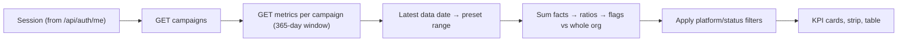

# UI-04 — Dashboard KPI Cards and Campaign Table

## 1. Overview

UI-04 replaces the dashboard's hardcoded KPI cards and the mock campaign table with live data from
the API-02 campaign endpoints. The dashboard shows the six PROD-01 KPIs for the selected filters, a
"Needs attention" strip for weak campaigns, and an accurate notice about which panels are still
sample data. The campaigns page shows a sortable comparison table where weak campaigns are visibly
highlighted.

API-02 serves campaigns and per-campaign daily metrics but no KPI summary, so UI-04 aggregates the
daily rows in the browser. It sums raw facts first and then computes every ratio from the sums. UI-04
is a Frontend task in `apps/web` and follows the ARCH-06 page → hook → service → `apiRequest` →
proxy path.

## 2. Scope

### In Scope

- The six dashboard KPI cards (Spend, Clicks, Conversions, CTR, CPA, ROAS) from real API-02
  responses, with deltas against the previous equal-length period when it has data.
- The campaign table: Campaign, Platform, Status, Spend, Clicks, Conv., CTR, CPC, CPA, ROAS,
  Performance. It has column sorting, a weak-row highlight, a legend and a "Showing N of M"
  footer.
- A shared filter bar (date preset, platform, status) stored in the URL query string.
- The UI-04 "Performance" flag: a labeled frontend display rule (Section 8).
- Loading, empty, no-data, error/retry, refreshing and 401 states (ARCH-06 §3–§4), including the
  central 401 rule for every query.
- A minimal campaign detail fix: the header comes from API-02, and the page never shows another
  campaign's data.
- Removal of the campaign mock (`lib/mock-data/campaigns.ts`) and of mock-only campaign types.

### Out of Scope

- Any backend, migration or `CampaignPublic` change, and any KPI endpoint (API-02 owner).
- Charts, the campaign performance view, and forecasts (UI-05). Anomalies and recommendations
  (UI-06, API-05). Simulation (UI-07). Export and reusable state components (UI-08).
- `canonical.json` and `known-deviations.json`: the contract gaps are reported in Section 15
  instead.
- The API client, proxy and session storage. These come from UI-02/UI-03 (PR #22) and are reused
  unchanged.

## 3. Prerequisites

| Task / Contract | Why Required |
|---|---|
| UI-02 / UI-03 (PR #22) | `apiRequest`, `ApiError`, the same-origin `/api/*` proxy and the real login session (`lib/session.ts`). The UI-04 branch is stacked on PR #22, which must merge first. |
| API-02 | The three campaign endpoints, documented in [`docs/api/API-02-dashboard-endpoints.md`](../api/API-02-dashboard-endpoints.md). |
| ARCH-06 (accepted decision) | The request path, the required UI states, and central 401 handling. |
| PROD-01 §2 | The six dashboard KPIs, their formulas, and CPC as a supporting field. Ratios are computed at read time. |
| QA-01 UI validator | `tests/contracts/validate-ui-types.mjs` maps `types/campaign.ts` to the canonical `campaigns` entity. |
| API-02 reviewed fixture (UI-04 entry contract) | **Not available.** The UI-04 entry contract asks to "use API-02 reviewed fixture and real-data checkpoint", but no API-02 fixture exists in the repository (the API-02 card promised one for 20 Oct). The live seeded API on the Nour dataset served as the real-data checkpoint, and the component tests use synthetic, schema-shaped fixtures (`apps/web/tests/helpers/dashboard-fixtures.ts`). Recorded as gap G7 (Section 15). |

No ADR applies. The canonical entity definition lives in `tests/contracts/canonical.json`; there is
no `docs/contracts` entry for campaign metrics yet.

## 4. Architecture

```text
Dashboard / Campaigns page
↓  useDashboardFilters (URL)          useCampaignPerformance (feature hook)
↓                                      ↓ useCampaigns + useCampaignMetrics (React Query)
↓                                      ↓ campaigns.service.ts → apiRequest → /api/* proxy → FastAPI API-02
↓                                      ↓ aggregate.ts (pure: sum, divide, flag)
KPI cards, Needs-attention strip, campaign table
```

Ownership boundaries:

- **FastAPI (API-02)** owns authorization, organization scope and the raw daily rows.
- **`features/dashboard/aggregate.ts`** owns summing, ratio derivation, date anchoring and the
  Performance flag. It is pure, has no React, and is unit-tested.
- **`hooks/useCampaigns.ts`** owns query keys and caching. Every key starts with the organization
  id.
- **`components/providers/query-provider.tsx`** owns the one central 401 rule (ARCH-06 §4).

## 5. Step-by-Step Implementation Walkthrough

### Practical Outcome

A Nour Fashion user signs in and opens the dashboard. They see the six KPIs for the last 90 days of
their own data: Spend 35,474.85, Clicks 52,669, Conversions 1,942, CTR 2.30%, CPA 18.27 and ROAS
2.74×. Above the cards, "Data through 20 Aug 2026" makes clear the data is not from today. A red
"Needs attention" strip names Summer Collection Push (CPA too high) and Evergreen Basics (ROAS
below 1.0×). Switching to "Last 30 days of data" shows deltas against the previous 30 days and
flags Flash Sale Banner instead of Summer. The campaigns table lists the weak campaigns first,
highlights them, and explains the rule under the table.

Terms:

- **CTR** = clicks ÷ impressions
- **CPA** = spend ÷ conversions
- **ROAS** = revenue ÷ spend
- **CPC** = spend ÷ clicks
- A **delta** is the relative change against the previous period of the same length.

### Acceptance Criteria → Steps and Evidence

| Acceptance Criterion | Implementation Step(s) | Verification Evidence / Status |
|---|---|---|
| "Agreed KPIs and campaign rows render from real API responses." | 1, 2, 3, 5 | Unit and component tests PASS (Section 14). Live E2E on the seeded database: every KPI card and all 56 numeric table cells match SQL. PASS. |
| "Required filters/status cues work." | 3, 4, 5 | Filter, sort, status badge, delta and state tests PASS. Live E2E with the Meta filter, `platform=google&status=active`, and 7/30/90/all presets: PASS. |
| "Weak campaign performance is visibly highlighted." | 2, 4, 5 | Flag rule unit tests PASS. Campaigns-page test (badge, `row-weak`, title reason) PASS. Live screenshots `05` and `04` show Summer/Evergreen (90 days) and Flash Sale/Evergreen (30 days) highlighted. PASS. |

### Step 1 — Call API-02 through the shared client

- **What:** Replace the mock campaign service with the three API-02 calls.
- **Where:** `apps/web/src/services/campaigns.service.ts` (`getCampaigns`, `getCampaign`,
  `getCampaignMetrics`) and `apps/web/src/hooks/useCampaigns.ts`.
- **How it works:**
  - The organization id and token come only from the stored session. That session is created from
    `/api/auth/me` at login.
  - Path segments are URI-encoded.
  - `useCampaignMetrics` issues one `useQueries` request per campaign (1 + N requests) for a fixed
    365-day window ending today (today included).
  - Query keys are `['campaigns', orgId]`, `['campaign', orgId, id]` and
    `['campaign-metrics', orgId, id, from, to]`.
- **Testing:** `tests/campaigns-service.test.ts` checks exact paths, query strings and the bearer
  token.

### Step 2 — Aggregate and flag in one pure module

- **What:** Turn daily rows into totals, ratios, date ranges and flags.
- **Where:** `apps/web/src/features/dashboard/aggregate.ts`, `types.ts`.
- **How it works:** The rules are in Section 8. `buildPerformance` flags every campaign against the
  whole organization, and only then does `filterPerformance` apply the platform and status filters.
- **Testing:** `tests/dashboard-aggregate.test.ts` (29 tests). They were written first and failed
  against a stub (28 failed, 1 passed), then passed after implementation.
  `tests/dashboard-review-fixes.test.ts` (9 tests) covers the independent-review findings. They also
  failed first (9 of 9), then passed after the fixes: window clamping, previous-period coverage,
  float tolerance at thresholds, and delta rounding.

### Step 3 — Compose one view state for both pages

- **What:** Produce exactly one state: `loading | error | empty | no-data | ready`, plus
  `isRefreshing`.
- **Where:** `features/dashboard/useCampaignPerformance.ts`, `hooks/useSession.ts`.
- **How it works:**
  - With no session, the hook redirects to `/login`.
  - A failed campaign list or any failed campaign metric gives `error`. A partially loaded
    organization is never aggregated.
  - Campaigns with no rows in the window give `no-data`.
  - In `ready`, the result carries totals for the filtered campaigns, the previous period (or
    `null` when it has no data), and the flagged rows.
- **Testing:** `tests/dashboard-page.test.tsx` covers loading (no zeros shown), empty, no-data,
  error with retry, partial failure, 401 and no session.

### Step 4 — Filters, badges, KPI cards and the Needs-attention strip

- **What:** The shared UI building blocks.
- **Where:** `features/dashboard/filters.ts`, `useDashboardFilters.ts`, `sort.ts`, `format.ts`,
  `components/*`.
- **How it works:**
  - Filters are read from and written to the URL (`range`, `platform`, `status`). Defaults are
    left out of the URL.
  - Badges always carry a text label.
  - The strip links to `/campaigns` with the same filters.
  - When the previous period has no data, a single muted line replaces all deltas.
- **Testing:** `tests/dashboard-filters.test.ts`, `tests/dashboard-sort.test.ts` and the page tests.

### Step 5 — Pages and central 401 handling

- **What:** Wire the dashboard, campaigns and campaign detail pages, and handle 401 once.
- **Where:**
  - `app/(app)/dashboard/page.tsx`
  - `app/(app)/campaigns/page.tsx`
  - `app/(app)/campaigns/[id]/page.tsx`
  - `components/providers/query-provider.tsx`
  - `lib/auth-redirect.ts`
- **How it works:**
  - `useSearchParams` sits inside a `<Suspense>` boundary.
  - The `QueryCache` `onError` hook calls `redirectToLogin()` on any 401. That clears the session
    and does a full navigation to `/login`, which also drops cached data.
  - Mutations are deliberately not covered, because `POST /api/auth/login` answers 401 for wrong
    credentials.
  - 4xx responses are not retried; 5xx and network errors are retried once.
  - The detail page shows "Campaign not found" for 404/422 and never falls back to another
    campaign.
- **Testing:** `tests/query-provider-401.test.tsx`, `tests/auth-redirect.test.ts`,
  `tests/campaign-detail-page.test.tsx`, `tests/campaigns-page.test.tsx`. Live E2E: an invalid
  token lands on `/login` with the session cleared.

### Flow Diagram



## 6. Inputs

| Field / Input | Type | Required | Source | Description |
|---|---|---|---|---|
| Session `organization.id`, `access_token` | string | Yes | `lib/session.ts`, set at login from `/api/auth/me` | Used in the API-02 path and the bearer header. It is never taken from the URL or user input. FastAPI enforces it. |
| `range` URL param | `7d \| 30d \| 90d \| all` | No (default `90d`) | URL | Date preset, anchored to the latest data date. Unknown values fall back to the default. |
| `platform` URL param | `all \| meta \| google` | No (default `all`) | URL | Filters KPIs, the strip and table rows. Does not change flags. |
| `status` URL param | `all \| active \| paused \| removed \| unknown` | No (default `all`) | URL | Same as platform. A `null` API status counts as `unknown`. |
| `CampaignPublic[]` | API-02 | Yes | `GET /api/orgs/{org}/campaigns` | Ordered by name. |
| `DailyMetricPublic[]` | API-02 | Yes | `GET /api/orgs/{org}/campaigns/{id}/metrics?from&to` | Raw facts are used. The per-day ratios from the API are not aggregated. |

## 7. Outputs

| Field / Output | Type | Nullable | Consumer | Description |
|---|---|---|---|---|
| KPI cards | Spend, Clicks, Conversions (numbers); CTR, CPA, ROAS (ratios) | Ratios yes | Dashboard user | Totals for filtered campaigns in the selected range. A null ratio shows "—" with a tooltip. |
| KPI delta | relative change | Yes | Dashboard user | Shown only when the previous equal-length period has data and the previous value is non-zero. |
| Performance flag | `weak \| average \| strong \| no_data` | No | Table, strip | UI-04 display rule (Section 8), labeled "Performance". Not the canonical AI `health_status`. |
| "Data through" label | date | No | Both pages | Latest date with data for the organization, plus the displayed range. |

## 8. Rules and Semantics

KPI formulas follow PROD-01 §2.1 and API-02 doc §15. They are listed here only for traceability.

- **Sum, then divide.** Each total sums the raw `spend`, `revenue`, `clicks`, `impressions` and
  `conversions` over the included rows. Then:
  - CTR = clicks ÷ impressions
  - CPC = spend ÷ clicks
  - CPA = spend ÷ conversions
  - ROAS = revenue ÷ spend

  Daily ratios are never averaged. For example, daily CTRs of 10% and 1% on 100 and 900
  impressions give a CTR of 1.9%, not 5.5%.
- **Zero denominators.** The ratio is `null` and displays as "—". It is never 0 or ∞.
- **Date anchoring.**
  - The fetch window is the 365 days ending today, today included (today − 364 → today), using
    the browser's local calendar date.
  - Presets end on the **latest date that has data** across the organization: Last 7/30/90 days
    of data, or All loaded data (window start → latest date).
  - A preset never starts before the fetch window. If it would, it is clamped to the window start,
    and the displayed range shows the clamped dates.
  - The default is **Last 90 days of data**.
  - "Data through D" is always shown, because the seeded data ends on 20 Aug 2026 and a
    today-anchored range would be empty.
- **Inclusive ranges.** Both boundary days are included. Date arithmetic works on `YYYY-MM-DD`
  strings through `Date.UTC`, so there is no timezone shift.
- **Previous period.** It has the same length and ends the day before the range starts. It is used
  only when it is **fully covered**: it starts inside the fetch window and on or after the earliest
  data date of the filtered campaigns, and it contains rows. Otherwise (and for "all"), no deltas
  are shown. Instead, one line reads "No earlier data to compare with for this range."
- **Delta rounding.** A relative change is rounded to the displayed 0.1% before its colour and
  arrow are chosen, so "0.0%" counts as no change.
- **Delta colours.**
  - Clicks, Conversions, CTR and ROAS: up is good (green).
  - CPA: up is bad (red).
  - Spend: neutral grey.
- **Performance flag (UI-04 frontend display rule).** The thresholds are
  `PERFORMANCE_RULE = { weakRoasBelow: 1.0, weakCpaRatio: 1.25 }`.
  - **Baseline:** every campaign in the selected range with spend > 0, ignoring the platform and
    status filters. Filtering therefore never changes a flag.
  - **No data:** spend = 0 in the range.
  - **Weak**, checked in this order:
    1. ROAS < 1.0
    2. spend > 0 with 0 conversions
    3. CPA > 1.25 × baseline CPA (skipped when the baseline CPA is null)
  - **Strong:** ROAS ≥ baseline ROAS **and** CPA ≤ baseline CPA.
  - **Average:** everything else.
  - **Tolerance:** threshold comparisons allow a relative tolerance of 1e-9. Money arrives as
    binary floats, so 0.1 + 0.2 must not count as above an exact 0.3 threshold.
  - **One campaign:** a campaign that is the organization's only spending campaign equals the
    baseline, so it is Strong by definition.
- **Default table order.** Weak, Average, Strong, No data. Within a group, higher spend comes
  first, then name. Null ratios sort last in either direction.
- **Numbers.** `en-US` formatting. Money has 2 decimals and **no currency label**, because the data
  carries none. CTR is shown as a percentage with 2 decimals, and ROAS as `2.74×`.
- **Determinism.** The same API data, filters and local date give the same output. Nothing is
  random.

## 9. Public Interfaces

- `campaigns.service.ts`: `getCampaigns(orgId, token)`, `getCampaign(orgId, id, token)`,
  `getCampaignMetrics(orgId, id, {from, to}, token)`. They throw `ApiError` on failure and have no
  side effects.
- `hooks/useCampaigns.ts`: `useCampaigns`, `useCampaign`, `useCampaignMetrics`.
- `features/dashboard/useCampaignPerformance(filters)`: returns the composed view state (Section 5,
  Step 3).
- `features/dashboard/aggregate.ts`: the pure functions behind Section 8.
- `components/providers/query-provider.tsx`: `createQueryClient()` with the central 401 rule.
- `lib/auth-redirect.ts`: `redirectToLogin()`.
- REST endpoints consumed (API-02, unchanged):
  - `GET /api/orgs/{org}/campaigns`
  - `GET /api/orgs/{org}/campaigns/{id}`
  - `GET /api/orgs/{org}/campaigns/{id}/metrics?from=YYYY-MM-DD&to=YYYY-MM-DD`

## 10. Data Ownership

### Reads

- API-02 campaign and daily-metric responses, for the session's organization only.
- The browser session (user, organization, token) written by the UI-03 login.

### Writes

- URL query parameters (filters).
- Clearing the browser session on 401 or when no session exists.

### Must Never Read

- The database, provider tokens, or any organization id from the URL or user input.

### Must Never Write

- Any organization-owned record. UI-04 is read-only against the API.

## 11. Security

- Organization scope comes from the session's `/api/auth/me` organization. FastAPI validates `{org}`
  against the token and returns 404 for any mismatch. The UI never trusts a client-chosen
  organization.
- Every React Query key starts with the organization id. On 401, `redirectToLogin()` clears the
  session and does a full page navigation, which discards all cached data.
- Errors show the safe `ApiError` message only. Tokens are never logged or rendered.
- The live verification registered a second organization. Its dashboard showed the empty state,
  and requesting a Nour campaign with its token returned 404 (Section 14).

## 12. Error and Edge-Case Behavior

| Case | Expected Behavior |
|---|---|
| No session stored | Redirect to `/login`; no API call. |
| 401 (expired or invalid token) | Session cleared; full navigation to `/login`. |
| 404/422 on campaign detail | "Campaign not found" with a back link; never another campaign. |
| 5xx or proxy 503 (API down) | Error panel with the safe message and Retry; retried once automatically first. |
| One campaign's metrics fail | Whole view shows the error state; partial totals are never shown. Retry refetches the campaign list too, so a campaign deleted in the meantime (404) recovers. |
| Organization with no campaigns | "No marketing data is available yet." plus a link to `/setup/connector`. |
| Campaigns but no rows in the 365-day window | Explains that there is no performance data in the last 12 months. |
| Filters match no campaigns | "No campaigns match these filters." |
| Zero denominators | Ratio "—" with a tooltip; the flag rule handles nulls (Section 8). |
| Previous period without data | No deltas; one muted line. |
| Duplicate records | N/A — API-02's `(campaign_id, date)` primary key prevents duplicates. |
| Background refresh | Data stays visible with "Updating data…". If the background refetch fails, the error panel with Retry replaces the data, so stale numbers are not shown as current. If the refreshed list contains a new campaign, the view shows loading until that campaign's metrics arrive. |
| Timeout / cancellation | No UI-04-specific timeout; React Query cancels queries on unmount. |

## 13. Testing

### Unit Tests

- `dashboard-aggregate.test.ts` (29) and `dashboard-review-fixes.test.ts` (9):
  - sum-then-divide vs averaged ratios, and zero denominators
  - empty organization, and campaigns with no rows
  - inclusive boundary days and the latest-data finder
  - preset and previous-period ranges across month, leap-year and year boundaries
  - local-date "today"
  - every flag branch, including exactly 1.25× and a null org CPA
  - flags staying independent of filters
  - percent change
  - range clamping to the fetch window, previous-period coverage, threshold tolerance, delta
    rounding
- `dashboard-filters.test.ts` (4), `dashboard-sort.test.ts` (3), `campaigns-service.test.ts` (4),
  `auth-redirect.test.ts` (1), `query-provider-401.test.tsx` (3).

### Integration Tests

- Component tests use the real `QueryClient` with a mocked service layer and synthetic,
  schema-shaped fixtures (`tests/helpers/dashboard-fixtures.ts`):
  - `dashboard-page.test.tsx` (14)
  - `campaigns-page.test.tsx` (6)
  - `campaign-detail-page.test.tsx` (3)

### E2E Impact

- No E2E suite is committed (no Playwright dependency was added). The live browser run is recorded
  in Section 14 and the PR. The release checklist "Login (browser)" and "Dashboard" rows are
  updated.

## 14. Verification

Commands executed on 21 Oct 2026, cloud session, Node v24.22.1, on branch
`feature/UI-04-dashboard-kpis-campaign-table` (PR #22 + `main` `4f71cf8` + UI-04 changes).

From `apps/web`:

```bash
npm ci
npm run lint
npm run type-check
npm test
npm run build
```

From the repo root:

```bash
node scripts/run-contracts.mjs
```

Results:

- Red-first: `npx vitest run tests/dashboard-aggregate.test.ts` against the stub → **FAIL** as
  intended (28 failed, 1 passed). After implementation → **PASS** (29/29), also under
  `TZ=Pacific/Kiritimati`, `America/Los_Angeles` and `Africa/Cairo`.
- `npm run lint` → **PASS** (0 errors; 1 pre-existing warning in `recommendations.service.ts`).
- `npm run type-check` → **PASS**.
- `npm test` → **PASS** (13 files, 83 tests).
- `npm run build` → **PASS**.
- `node scripts/run-contracts.mjs` → **PASS** (5/5; UI validator: no deviations).
- **Live E2E** → **PASS**. Setup:
  - throwaway PostgreSQL 16 on port 5441
  - `alembic upgrade head`
  - QA-00 demo seed
  - uvicorn and `next dev` behind the proxy
  - browser login as `demo@nourfashion.example`

  Checked:
  - KPIs match SQL for last 90 / all / 30 / 7 days and for Meta.
  - The 56 table cells match SQL.
  - The 30-day deltas match SQL.
  - An invalid token redirects to `/login`.
  - The second organization sees the empty state and gets 404 for a Nour campaign.
  - With the API stopped, the error state appears with Retry.
- **Dark mode** → **PASS** after one fix. Dashboard and campaigns were checked with the dark theme
  (`sawakli-dark` = `dark`). The small UI-04 texts (data-through range, muted line, attention
  reasons, legend, table footer, state messages) used `--color-text-muted`, which measured 3.6–4.0:1
  on dark backgrounds. They were switched to the existing `--color-text-secondary` token: now
  6.7–7.5:1 in dark mode, and darker (higher contrast) in light mode. The Weak badge (9.4:1), the
  strip title (9.0:1) and the sample badge (11.0:1) already passed. After the fix, lint,
  type-check, test and build all PASS.
- Documentation governance (`check-documentation-governance.sh 4f71cf8 HEAD`) → **FAIL (pending)**.
  Its only failure is PR #22's `docs/ui/UI-02-ui-foundation-and-api-client.md` (16-section headings
  in a document that is new at the base). This document passes. It is fixed either by updating #22
  or by converting that document.
- Implementation verified on commit `0f8b3fe`.
- CI on [PR #31](https://github.com/elfaroukomaradmission-a11y/Sawakli-AI/pull/31), workflow "Sawakli AI CI" (`pull_request`), run
  [39651683108](https://github.com/elfaroukomaradmission-a11y/Sawakli-AI/actions/runs/39651683108), head `73a23cc`. Results as read from the PR page by
  Mohamed Hassan; this session could not read the team repository's Actions.
  - Documentation governance: **FAIL**. Its only failure is PR #22's
    `docs/ui/UI-02-ui-foundation-and-api-client.md` (missing 17-section headings); this document passes.
  - Contracts: **PASS**
  - Backend: **PASS**
  - Frontend: **PASS**
  - Integration: **PASS**

## 15. Known Limitations

- **G1:** There is no KPI/summary endpoint, and the campaign list carries no totals or date filters
  (unlike the INT-01 §2 endpoint table). UI-04 aggregates client-side with 1 + N requests over a
  fixed 365-day window. Data older than 365 days is not shown. Owners: Ahmed Ibrahem (API-02) and
  Mohamed Hassan (INT-01).
- **G2:** `CampaignPublic` omits `organization_id`, which canonical includes and the UI validator
  requires. The frontend type marks it optional. Owners: Ahmed Ibrahem / INT-01.
- **G3:** Canonical lists `health_status` as AI-computed, but nothing serves it. The "Performance"
  flag is a labeled frontend display rule. Owners: Hussein Elhaddad (AI) / INT-01.
- **G4:** The QA-00 backend contract validator does not map `CampaignPublic` or
  `DailyMetricPublic`, and `canonical.json` has no `daily_metrics` entity, so the frontend
  `DailyMetric` type is not validator-mapped either. Owner: Mohamed Hassan (System QA), as a
  separate PR.
- **G5:** Neither the data nor the API carries a currency, so amounts are shown unlabeled. Owner:
  INT-01 / PROD-01.
- **G6:** The API-02 task document still shows `NOT RUN` / `TBD` entries. Observation only. Owner:
  Ahmed Ibrahem.
- **G7:** The UI-04 entry contract asks for an "API-02 reviewed fixture and real-data checkpoint",
  but no API-02 fixture exists in the repository (the API-02 card promised one for 20 Oct). The live
  seeded API on the Nour dataset served as the real-data checkpoint, and the component tests use
  synthetic, schema-shaped fixtures. Owner: Ahmed Ibrahem (API-02).
- The Google platform badge uses `--color-badge-google-*`, which has no dark-mode values in
  `tokens.css` (pre-existing UI-01 tokens), so it stays light in dark mode. Owner: Abdulrahman Ehab
  (UI-01 tokens / UI-09 polish).
- A campaign that is the organization's only spending campaign is always Strong, because it equals
  the baseline.
- The flag is threshold-based. Over the last 30 days of seed data, Summer Collection Push sits at
  CPA 27.66 against a weak threshold of 27.75, so small data changes can flip it.
- The Active Anomalies, Pending Recommendations and chart panels remain labeled sample content
  (UI-05/UI-06).

## 16. Follow-Up Tasks

- `API-02` follow-up — Ahmed Ibrahem — a KPI/summary endpoint, or per-campaign totals with
  `from`/`to`, to replace the client-side aggregation (G1).
- `INT-01` — Mohamed Hassan — decide on `organization_id` in `CampaignPublic` (G2), the source of
  `health_status` (G3), and currency (G5).
- `QA-00` follow-up — Mohamed Hassan — map the API-02 response models in the backend validator and
  add `daily_metrics` to `canonical.json` (G4).
- `UI-05` — Abdulrahman Ehab — the campaign performance view and charts on the detail page.
- `UI-08` — Abdulrahman Ehab — reusable loading/empty/error components that can replace the local
  `DataState` markup.

## 17. References and Evidence

- Notion task: UI-04 — Build Dashboard KPI Cards and Campaign Table.
- Pull request: [#31](https://github.com/elfaroukomaradmission-a11y/Sawakli-AI/pull/31), from
  `mohamedhassan420:feature/UI-04-dashboard-kpis-campaign-table` (stacked on PR #22; merge #22 first).
- Canonical contracts: `tests/contracts/canonical.json` (entity `campaigns`); PROD-01 §2 KPI set.
- ADRs: N/A — no architectural change. ARCH-06 (accepted decision record) governs the client and
  state conventions.
- Related technical documentation: [API-02](../api/API-02-dashboard-endpoints.md),
  [release checklist](../testing/release-checklist.md).
- Test or CI evidence: Section 14, the pull request description, and CI run
  [39651683108](https://github.com/elfaroukomaradmission-a11y/Sawakli-AI/actions/runs/39651683108).
